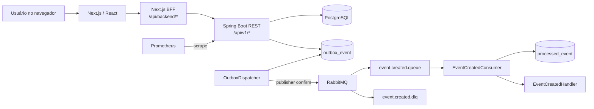
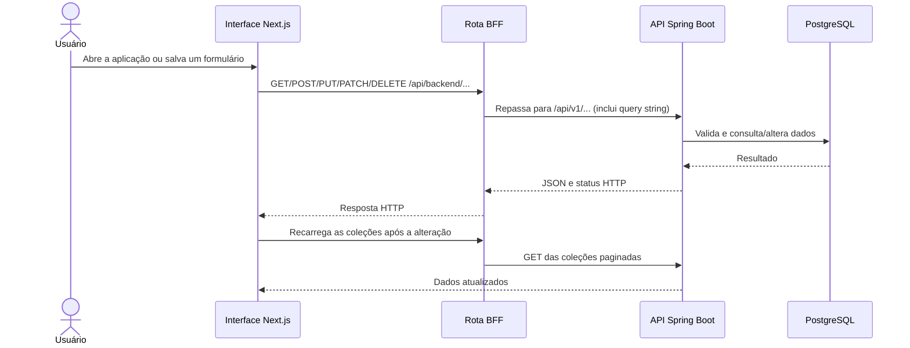
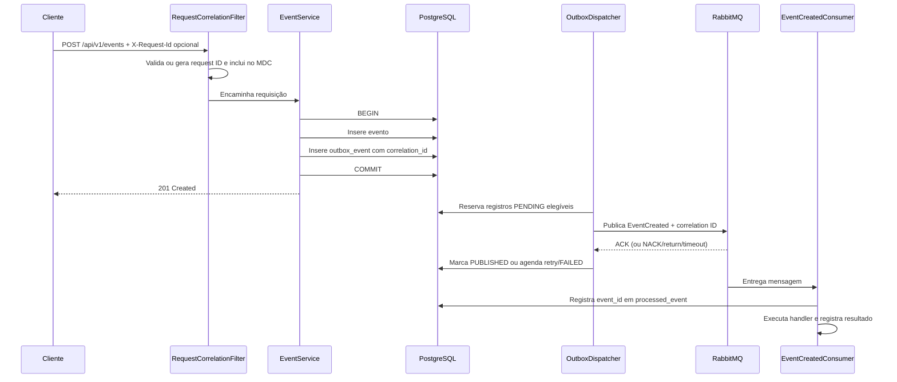
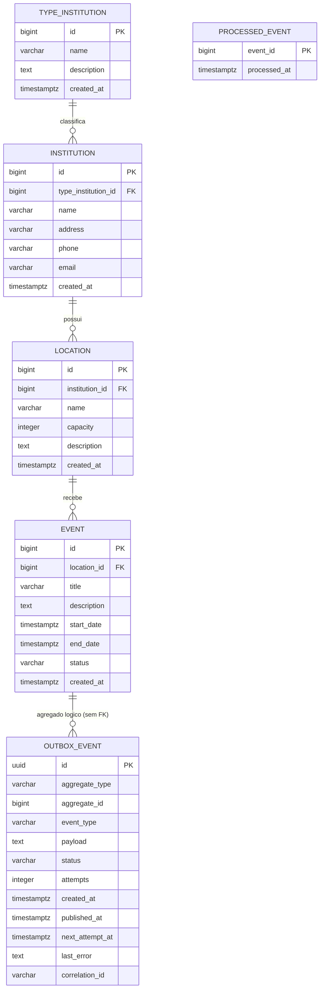
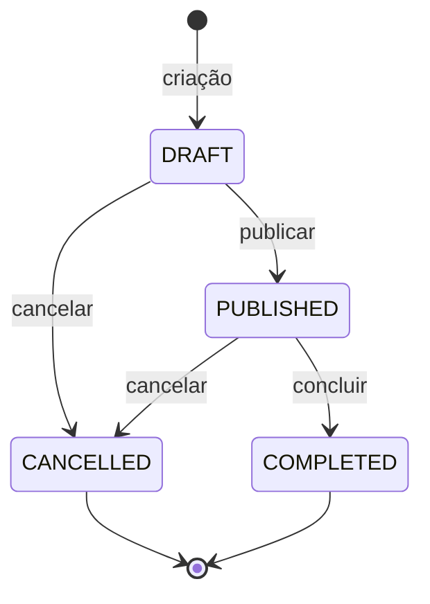

# Event Manager

Sistema web para administrar tipos de instituição, instituições, locais e
eventos. A interface Next.js consome uma API REST Spring Boot; o PostgreSQL é a
fonte transacional dos dados, e o RabbitMQ recebe eventos de domínio por meio
de um Transactional Outbox.

Este documento descreve o funcionamento atual do código, como executar o
projeto, os contratos da API, o modelo de dados, as regras de negócio, a
estrutura dos módulos e o escopo dos testes.

## Índice

- [Visão geral](#visão-geral)
- [Arquitetura e fluxos](#arquitetura-e-fluxos)
- [Tecnologias e pré-requisitos](#tecnologias-e-pré-requisitos)
- [Executar o projeto](#executar-o-projeto)
- [Backend](#backend)
- [Modelo de dados](#modelo-de-dados)
- [API REST](#api-rest)
- [Regras de negócio](#regras-de-negócio)
- [Frontend](#frontend)
- [Mensageria e confiabilidade](#mensageria-e-confiabilidade)
- [Operação e observabilidade](#operação-e-observabilidade)
- [Testes e CI](#testes-e-ci)
- [Estrutura do repositório](#estrutura-do-repositório)
- [Limitações e próximos passos](#limitações-e-próximos-passos)

## Visão geral

O sistema mantém quatro cadastros relacionados:

1. **Tipo de instituição** classifica uma instituição.
2. **Instituição** pertence a um tipo.
3. **Local** pertence a uma instituição.
4. **Evento** acontece em um local, em um intervalo de tempo, e possui status.

O backend aplica validações de entrada e regras de negócio, persiste os dados
em PostgreSQL e publica `EventCreated` no RabbitMQ. A criação do evento e seu
registro no Outbox são confirmados ou revertidos juntos na mesma transação.
Assim, uma indisponibilidade temporária do broker não perde a notificação: um
dispatcher tenta publicá-la novamente.

## Arquitetura e fluxos



### Fluxo de leitura e gravação pela interface



### Fluxo de criação de evento e publicação assíncrona



## Tecnologias e pré-requisitos

| Componente | Tecnologia |
| --- | --- |
| Backend | Java 21, Spring Boot 4.1.2, Maven |
| Persistência | PostgreSQL 17, Spring Data JPA/Hibernate, Flyway |
| Mensageria | RabbitMQ 4, Spring AMQP |
| Métricas | Spring Actuator, Micrometer, Prometheus |
| Frontend | Next.js 15, React 18, TypeScript |
| Testes backend | JUnit 5, Mockito, Spring Test, Testcontainers |
| Testes frontend | Não há runner/script de testes configurado atualmente |
| Execução local isolada | Docker e Docker Compose |

Para executar localmente, instale Docker com suporte a containers, Java 21
(para compilar/executar o backend diretamente) e Node.js 20+ (para trabalhar no
frontend fora do Docker). Os testes de integração com Testcontainers também
precisam de um daemon Docker acessível.

## Executar o projeto

### Aplicação completa em desenvolvimento

Na raiz do repositório:

```sh
docker compose up --build
```

Endereços padrão:

| Serviço | Endereço no host |
| --- | --- |
| Frontend | `http://localhost:3000` |
| API backend | `http://localhost:8081` |
| PostgreSQL | Disponível apenas na rede interna do Compose |
| RabbitMQ | Disponível apenas na rede interna do Compose |

O backend escuta na porta `8080` dentro da rede Docker e publica a porta
`8081` no host por padrão. `BACKEND_PORT` altera a porta do host. O Compose de
desenvolvimento define credenciais padrão (`event_manager_dev`) caso as
variáveis de ambiente não sejam fornecidas; elas são somente para
desenvolvimento e não devem ser reutilizadas em produção.

Para parar os serviços, use `Ctrl+C` no terminal do Compose ou:

```sh
docker compose down
```

Os volumes nomeados preservam os dados. Para remover os volumes e os dados
locais, faça isso conscientemente com `docker compose down -v`.

### Executar serviços de infraestrutura e aplicações separadamente

Inicie PostgreSQL e RabbitMQ com o Compose de desenvolvimento:

```sh
docker compose -f backend/compose.yaml up -d
```

Em um terminal, execute a API:

```powershell
cd backend
.\mvnw.cmd spring-boot:run
```

Em outro terminal, execute o frontend:

```powershell
cd frontend
npm ci
npm run dev
```

O Next.js encaminha as chamadas para `http://localhost:8080` por padrão quando
`BACKEND_API_URL` não é definido. Para apontar para outro backend, defina essa
variável no processo do frontend. O navegador acessa a API pela rota local
`/api/backend/*`, não diretamente pelo hostname interno Docker.

### Compose de produção

O arquivo [docker-compose.production.yml](./docker-compose.production.yml)
exige secrets explícitos e não publica as portas do PostgreSQL/RabbitMQ. Antes
de validar ou iniciar, configure no ambiente do processo:

- `DB_PASSWORD`
- `RABBITMQ_USERNAME`
- `RABBITMQ_PASSWORD`

No PowerShell:

```powershell
$env:DB_PASSWORD = "<secret>"
$env:RABBITMQ_USERNAME = "<usuario>"
$env:RABBITMQ_PASSWORD = "<secret>"
docker compose -f docker-compose.production.yml config
docker compose -f docker-compose.production.yml up --build -d
```

No shell POSIX:

```sh
export DB_PASSWORD='<secret>'
export RABBITMQ_USERNAME='<usuario>'
export RABBITMQ_PASSWORD='<secret>'
docker compose -f docker-compose.production.yml config
docker compose -f docker-compose.production.yml up --build -d
```

O frontend é exposto em `FRONTEND_PORT` (padrão `3000`) e o Prometheus em
`PROMETHEUS_PORT` (padrão `9090`, limitado a loopback). Configure TLS e
controle de acesso em um proxy/ingress externo antes de expor a aplicação.
Credenciais devem vir de um secret manager do ambiente; não as grave no
repositório, em imagens ou em arquivos versionados.

## Backend

### Responsabilidades e camadas

O backend segue uma organização por domínio. Para cada recurso, os controllers
expõem os endpoints, services coordenam regras/transações, repositories
executam consultas e entidades JPA representam o estado persistido. DTOs
separam o contrato HTTP do modelo interno.

| Pacote | Responsabilidade |
| --- | --- |
| `event` | Eventos, agenda, status, integração com Outbox e mensagem `EventCreated` |
| `institution` | Cadastro de instituições e referência ao tipo |
| `institutiontype` | Cadastro de tipos de instituição |
| `location` | Cadastro de locais e referência à instituição |
| `outbox` | Persistência, despacho, retry e métricas do Outbox |
| `config` | Topologia RabbitMQ e filtro de correlação HTTP |
| `shared.exception` | Exceções de domínio e tradução para HTTP |
| `shared.pagination` | Validação de paginação e formato da resposta |

### Estrutura por recurso

Cada recurso principal contém, em geral:

- **Entidade**: mapeia a tabela e as relações do banco.
- **Repository**: estende `JpaRepository`; métodos derivados e consultas JPQL
  implementam busca e paginação.
- **Service**: valida dependências e regras de domínio, executa transações e
  converte entidade para DTO.
- **Controller**: define os caminhos HTTP, valida payloads e status de resposta.
- **DTOs**: records de request/response, com validação declarativa onde
  aplicável.

### Anotações e mecanismos utilizados

| Anotação/mecanismo | Uso neste projeto |
| --- | --- |
| `@Entity`, `@Table` | Declaram as classes e tabelas persistidas por JPA. |
| `@Id`, `@GeneratedValue` | Definem chave primária e geração de IDs identity. |
| `@ManyToOne(fetch = LAZY, optional = false)` | Representa vínculos obrigatórios com carregamento sob demanda. |
| `@JoinColumn` | Define colunas de chave estrangeira, como `location_id`. |
| `@Column` | Define nulabilidade, nome, tamanho e tipo SQL de campos. |
| `@Enumerated(EnumType.STRING)` | Persiste status como texto legível, não como ordinal. |
| `@CreationTimestamp` | Preenche timestamps de criação controlados pelo Hibernate. |
| `@RestController`, `@RequestMapping` | Expõem controladores REST e suas rotas-base. |
| `@GetMapping`, `@PostMapping`, `@PutMapping`, `@PatchMapping`, `@DeleteMapping` | Associam verbos HTTP a operações do recurso. |
| `@RequestBody`, `@PathVariable`, `@RequestParam` | Fazem binding do corpo, caminho e query string. |
| `@Valid` e constraints Jakarta Validation | Validam DTOs antes de chamar a regra de negócio. |
| `@Service` | Marca componentes da camada de negócio. |
| `@Transactional`, `readOnly = true` | Define limites transacionais e otimiza operações de leitura. |
| `@Repository` via Spring Data | Implementa operações JPA a partir das interfaces. |
| `@Query`, `@Param`, `@Lock(PESSIMISTIC_WRITE)` | Definem consultas de domínio e reserva concorrente de mensagens Outbox. |
| `@Component`, `@Scheduled` | Registra o dispatcher e agenda varreduras periódicas do Outbox. |
| `@RabbitListener` | Liga o método consumer à fila de eventos. |
| `@Configuration`, `@Bean` | Declara exchanges, filas, bindings e conversor JSON de mensagens. |
| `@RestControllerAdvice`, `@ExceptionHandler` | Padronizam a tradução de erros para respostas HTTP. |
| `@Order` e `OncePerRequestFilter` | Executam o filtro de request ID antes dos demais filtros servlet. |

### Fluxo de uma chamada no backend

1. `RequestCorrelationFilter` recebe ou gera um `X-Request-Id`, coloca-o no
   MDC e devolve o identificador no header da resposta.
2. O controller faz binding de path/query/body. `@Valid` rejeita DTOs inválidos.
3. O service aplica regras de negócio e abre a transação com `@Transactional`.
4. O repository carrega ou persiste entidades; Flyway é responsável por criar
   e evoluir o esquema.
5. O controller devolve DTOs, nunca expõe diretamente as entidades JPA.
6. Exceções conhecidas são convertidas pelo `GlobalExceptionHandler`; erros
   inesperados são registrados e retornam uma resposta genérica `500`.

### Validação dos DTOs

| DTO | Regras principais |
| --- | --- |
| `TypeInstitutionRequest` | Nome obrigatório, não branco e até 100 caracteres; descrição até 2.000. |
| `InstitutionRequest` | Nome obrigatório até 150; `typeInstitutionId` obrigatório e positivo; endereço até 300; telefone até 50; e-mail válido até 254. |
| `LocationRequest` | Nome obrigatório até 150; `institutionId` obrigatório e positivo; capacidade zero ou positiva; descrição até 2.000. |
| `EventRequest` | Título obrigatório até 150; descrição até 1.000; início, fim, local positivo e status obrigatórios. O service também exige fim posterior ao início. |
| `EventStatusRequest` | Status obrigatório e pertencente ao enum `EventStatus`. |

Os limites definidos no request são o contrato de entrada, ainda que algumas
colunas SQL tenham capacidade maior (por exemplo, o título da tabela aceita
até 200, mas o DTO limita a 150).

## Modelo de dados

Flyway mantém o esquema versionado em
`backend/src/main/resources/db/migration`. O Hibernate está em modo
`ddl-auto=validate`: valida os mapeamentos em relação ao esquema, mas não
substitui migrations.

### Diagrama relacional



`processed_event.event_id` é a chave idempotente do consumer. `outbox_event`
não possui foreign key polimórfica para `event`: `aggregate_type` e
`aggregate_id` identificam o agregado sem acoplar o Outbox a uma única tabela.

### Tabelas e integridade

| Tabela | Conteúdo e regras |
| --- | --- |
| `type_institution` | `id` identity, `name` obrigatório (100), `description` e `created_at`. |
| `institution` | `id`, `type_institution_id` obrigatório, nome (150), endereço (300), telefone (50), e-mail (254), `created_at`. FK para tipo com `ON DELETE RESTRICT`. |
| `location` | `id`, instituição obrigatória, nome (150), capacidade (default 0, `>= 0`), descrição, `created_at`. FK para instituição com `ON DELETE RESTRICT`. |
| `event` | `id`, local obrigatório, título (200), descrição, início/fim com timezone, status, `created_at`. FK para local com `ON DELETE RESTRICT`; check de datas e status. |
| `outbox_event` | UUID, tipo/ID de agregado, tipo e payload do evento, status, tentativas, datas de criação/publicação/próxima tentativa, último erro e correlação. Checks de status e tentativas não negativas. |
| `processed_event` | `event_id` como PK e data de processamento; impede processar o mesmo ID duas vezes com efeito duplicado. |

Índices relevantes incluem as FKs de instituição/local/evento, status e início
dos eventos, e `(status, next_attempt_at, created_at)` para buscar o backlog do
Outbox.

A migration V2 cria uma constraint de exclusão PostgreSQL usando GiST e
`tstzrange(..., '[)')`: impede sobreposição de eventos ativos no mesmo local,
mesmo sob concorrência. A borda final do intervalo é exclusiva, portanto um
evento pode começar exatamente quando o anterior termina. A constraint só se
aplica a `DRAFT` e `PUBLISHED`.

### Evolução das migrations

| Migration | Alterações |
| --- | --- |
| `V1__create_initial_tables.sql` | Tabelas de domínio, Outbox inicial, FKs, checks e índices básicos. |
| `V2__outbox_and_event_integrity.sql` | `processed_event` e constraint de exclusão de agenda ativa. |
| `V3__complete_frontend_fields.sql` | Descrições, dados de contato, capacidade e constraint de capacidade. |
| `V4__outbox_correlation_id.sql` | `correlation_id` persistido no Outbox. |

## API REST

Prefixo de recursos: `/api/v1`. A API não implementa autenticação/autorização
própria atualmente; em implantação real, proteja-a no gateway/ingress conforme
os requisitos do ambiente.

### Endpoints

| Recurso | Método e caminho | Operação | Resposta de sucesso |
| --- | --- | --- | --- |
| Tipos de instituição | `GET /institution-types` | Lista paginada | `200` |
|  | `GET /institution-types/{id}` | Busca por ID | `200` |
|  | `POST /institution-types` | Cria tipo | `201` |
|  | `PUT /institution-types/{id}` | Atualiza nome/descrição | `200` |
|  | `DELETE /institution-types/{id}` | Exclui tipo sem dependentes | `204` |
| Instituições | `GET /institutions` | Lista paginada | `200` |
|  | `GET /institutions/type/{typeInstitutionId}` | Lista paginada por tipo | `200` |
|  | `GET /institutions/{id}` | Busca por ID | `200` |
|  | `POST /institutions` | Cria instituição | `201` |
|  | `PUT /institutions/{id}` | Atualiza cadastro | `200` |
|  | `DELETE /institutions/{id}` | Exclui instituição sem locais | `204` |
| Locais | `GET /locations` | Lista paginada | `200` |
|  | `GET /locations/institution/{institutionId}` | Lista paginada por instituição | `200` |
|  | `GET /locations/{id}` | Busca por ID | `200` |
|  | `POST /locations` | Cria local | `201` |
|  | `PUT /locations/{id}` | Atualiza cadastro | `200` |
|  | `DELETE /locations/{id}` | Exclui local sem eventos | `204` |
| Eventos | `GET /events` | Lista paginada | `200` |
|  | `GET /events/location/{locationId}` | Lista paginada por local | `200` |
|  | `GET /events/{id}` | Busca por ID | `200` |
|  | `POST /events` | Cria evento e registro Outbox | `201` |
|  | `PUT /events/{id}` | Atualiza dados do evento | `200` |
|  | `PATCH /events/{id}/status` | Transiciona status | `200` |
|  | `DELETE /events/{id}` | Exclui evento | `204` |

Todos os recursos paginados aceitam:

| Parâmetro | Padrão | Regra |
| --- | --- | --- |
| `page` | `0` | Inteiro maior ou igual a zero. |
| `size` | `20` | Entre 1 e 100. |
| `sort` | `createdAt` | Campo permitido por recurso (veja abaixo). |
| `direction` | `desc` | `asc` ou `desc`. |

Campos ordenáveis:

- Eventos: `id`, `createdAt`, `title`, `startDate`, `endDate`, `status`.
- Instituições: `id`, `createdAt`, `name`.
- Locais: `id`, `createdAt`, `name`, `capacity`.
- Tipos: `id`, `createdAt`, `name`.

Quando a ordenação principal não é `id`, a API acrescenta `id ASC` como
critério secundário para estabilizar a paginação.

Formato de qualquer página:

```json
{
  "content": [],
  "page": 0,
  "size": 20,
  "totalElements": 0,
  "totalPages": 0,
  "first": true,
  "last": true
}
```

### Campos dos contratos JSON

As propriedades são em inglês na API (por exemplo `typeInstitutionId`,
`locationId`, `startDate`) e o frontend traduz para os nomes usados na
interface. Datas são ISO-8601 com offset/timezone.

| Payload de criação/atualização | Campos |
| --- | --- |
| Tipo | `name`, `description` |
| Instituição | `name`, `typeInstitutionId`, `address`, `phone`, `email` |
| Local | `name`, `institutionId`, `capacity`, `description` |
| Evento | `title`, `description`, `locationId`, `startDate`, `endDate`, `status` |
| Status de evento | `status` |

Os DTOs de resposta também incluem IDs, timestamps e nomes úteis das relações
(por exemplo `institutionName` ou `locationName`), evitando que o cliente
precise consultar uma relação para identificar a entidade exibida.

### Erros HTTP

| Status | Uso |
| --- | --- |
| `400 Bad Request` | Bean Validation, argumento/query inválido, JSON ilegível ou transição de status inválida. Corpo: `{"error":"..."}`. |
| `404 Not Found` | ID de recurso ou relação referenciada inexistente. |
| `409 Conflict` | Colisão de agenda ou violação de integridade/relação no banco. |
| `500 Internal Server Error` | Falha inesperada; o detalhe técnico fica nos logs, não no corpo público. |

## Regras de negócio

### Hierarquia de cadastros

- Uma instituição precisa referenciar um tipo existente.
- Um local precisa referenciar uma instituição existente.
- Um evento precisa referenciar um local existente.
- FKs usam `ON DELETE RESTRICT`; não se pode excluir um pai com filhos
  dependentes. A API traduz violações de integridade para `409`.
- A listagem filtrada verifica a existência do recurso pai e retorna `404`
  quando o ID pai não existe, mesmo que a coleção resultante fosse vazia.

### Agenda e status de evento



- `DRAFT` e `PUBLISHED` reservam o intervalo do local.
- `CANCELLED` e `COMPLETED` não ocupam agenda.
- Eventos ativos não podem se sobrepor no mesmo local; eventos de locais
  diferentes podem ocorrer simultaneamente.
- O término deve ser estritamente posterior ao início.
- Intervalos encostados são permitidos: `[09:00, 10:00)` não conflita com
  `[10:00, 11:00)`.
- Eventos cancelados/concluídos não podem ser editados nem ter o status
  alterado. O evento publicado pode ter dados editados, mas não pode voltar
  para rascunho.
- O backend cria um evento de domínio `EventCreated` ao criar evento,
  independentemente do status inicial; a aplicação consumidora atual registra
  o processamento em log, deixando integrações adicionais para evolução.

## Frontend

### Aplicação ativa e organização

A aplicação executada pelo Docker e por `npm run dev` é o App Router do
Next.js, localizado em `frontend/app`. `frontend/src` contém uma implementação
anterior de interface; não é a árvore de entrada usada pelos scripts atuais
(`next dev`, `next build`, `next start`).

| Caminho | Responsabilidade |
| --- | --- |
| `frontend/app/page.tsx` | Página cliente, estado global das quatro coleções, carregamento inicial e abas. |
| `frontend/app/layout.tsx` | Layout raiz, idioma `pt-BR`, CSS global e metadados. |
| `frontend/app/components/*-form.tsx` | Formulários e listas CRUD por entidade. |
| `frontend/app/api/backend/[...path]/route.ts` | BFF/proxy same-origin para a API Spring. |
| `frontend/lib/api.ts` | Cliente HTTP, tratamento de erros e leitura de todas as páginas. |
| `frontend/components/ui` | Componentes visuais reutilizáveis baseados em Radix/shadcn. |

### Carregamento e estado da página

Ao abrir a página, `page.tsx` dispara quatro leituras em paralelo
(`Promise.all`): tipos, instituições, locais e eventos. `apiRequestAll` solicita
cada coleção com `size=100`, segue `totalPages` até concluir e devolve o array
completo ao cliente. A interface traduz os DTOs da API para modelos em
português, converte IDs para strings e datas ISO para `Date`.

Os formulários recebem os dados por props. Após criar, editar ou excluir, a
página recarrega as coleções para manter os relacionamentos e contagens
coerentes. Durante o carregamento inicial existe indicador; falhas de carga
oferecem ação para tentar novamente. Falhas de formulário são exibidas junto
ao próprio formulário.

### Fluxo do proxy BFF

1. O cliente chama `/api/backend/{recurso}` na mesma origem do Next.js.
2. A rota catch-all constrói `/api/v1/{recurso}` em `BACKEND_API_URL` e preserva
   a query string.
3. Encaminha método, `Content-Type`, corpo (exceto `GET`/`HEAD`) e
   `X-Request-Id`, quando enviado.
4. Devolve o status/corpo do backend, inclusive resposta sem corpo `204`, e
   repassa `X-Request-Id` de volta ao navegador.
5. O cache é desativado nas chamadas para evitar dados persistidos obsoletos.

Essa rota evita que o browser precise conhecer o hostname interno do backend
na rede Docker. Ela não é uma camada de autenticação: políticas de identidade,
acesso, CORS externo e TLS precisam ser aplicadas conforme o ambiente.

### Interações disponíveis

- **Tipos:** criar, editar e excluir tipo; nome e descrição.
- **Instituições:** criar/editar/excluir; tipo obrigatório e dados opcionais de
  endereço, telefone e e-mail. A criação fica desabilitada sem um tipo.
- **Locais:** criar/editar/excluir; instituição obrigatória, capacidade e
  descrição. A criação fica desabilitada sem instituição.
- **Eventos:** criar/editar/excluir; local, data/hora, descrição e status.
  A edição fica desabilitada para evento cancelado/concluído; a criação fica
  desabilitada sem local.

Na edição de evento, o formulário envia os dados com `PUT` e, se o status
mudou, envia em seguida `PATCH /status`. São duas requisições HTTP separadas;
se a segunda falhar, a atualização dos demais dados já pode ter sido gravada.
O backend continua sendo a autoridade para regras e transições de status.

O cliente formata mensagens conhecidas para erros `400`, `404`, `409` e erros
de servidor. Para `204`, não tenta interpretar JSON. Erros de rede recebem
mensagem de conexão indisponível.

## Mensageria e confiabilidade

### Transactional Outbox

Ao criar evento, `EventService` grava `event` e chama `OutboxService.save`
dentro da mesma transação. O serviço Outbox exige transação existente
(`Propagation.MANDATORY`), serializa o payload e persiste `PENDING`, o tipo,
ID agregado e o `X-Request-Id` atual (se houver).

O dispatcher roda periodicamente e:

1. Busca até `outbox.dispatcher.batch-size` mensagens `PENDING` vencidas,
   ordenadas pela criação e bloqueadas para escrita (`PESSIMISTIC_WRITE`).
2. Desserializa os eventos suportados e publica no exchange
   `event.exchange`, routing key `event.created.v1`.
3. Aguarda confirmação correlacionada do RabbitMQ.
4. Marca `PUBLISHED` somente com ACK e sem mensagem retornada (publisher
   returns/mandatory).
5. Em NACK, retorno, timeout, erro de conversão ou publicação, grava a
   mensagem de erro e agenda novo processamento.
6. Ao alcançar o limite de tentativas, marca `FAILED`; não descarta o registro
   e deixa o erro disponível para diagnóstico.

Configuração padrão: varredura a cada 1.000 ms, lotes de 100, até 5 tentativas,
timeout de confirmação de 10.000 ms, backoff exponencial começando em 1.000 ms
e limitado a 60.000 ms. Valores podem ser substituídos por propriedades
`outbox.dispatcher.*`.

### RabbitMQ, retry e DLQ

`RabbitMQConfig` declara o exchange tópico `event.exchange`, a fila
`event.created.queue`, routing key `event.created.v1`, exchange de dead-letter
`event.dlx` e fila `event.created.dlq`. A fila principal envia mensagens
rejeitadas sem requeue para a DLQ.

O listener tem retry local com padrão de 3 tentativas, intervalo inicial de
1.000 ms, multiplicador 2 e limite de 10.000 ms. Se o processamento continuar
falhando, a mensagem é rejeitada e encaminhada para DLQ. Mensagens JSON
malformadas também são testadas e roteadas para DLQ.

O consumer grava `event_id` em `processed_event` antes de executar o handler,
na mesma transação. Duplicatas não executam o handler novamente. Se ocorrer
exceção, a transação reverte e a entrega pode ser tentada de novo; depois dos
retries do listener, a mensagem é encaminhada à DLQ.

O handler atual é uma implementação inicial que registra o evento em log. O
fluxo de fila, retries, idempotência e DLQ está implementado; notificações,
e-mail ou outras integrações são extensões futuras.

### Recuperação operacional

- **`PENDING` acumulando:** verificar saúde/conectividade do RabbitMQ, confirms,
  returns e erros do dispatcher. O serviço tenta novamente automaticamente
  após `next_attempt_at`.
- **`FAILED`:** inspecionar `last_error`, corrigir a causa e decidir uma
  estratégia operacional de reprocessamento; não existe endpoint de replay
  administrativo implementado.
- **DLQ com mensagens:** inspecionar payload e headers (`x-death`), determinar
  a causa e decidir replay ou descarte controlado. Não existe ferramenta de
  replay integrada à interface/API.
- **Consumer com erro:** acompanhar os counters/logs, verificar banco e handler,
  e confirmar o estado da DLQ.

## Operação e observabilidade

### Correlação e logs

`RequestCorrelationFilter` aceita `X-Request-Id` somente no formato
`[A-Za-z0-9._-]{1,64}`; valor ausente ou fora do padrão é substituído por UUID.
O valor é colocado em MDC como `requestId`, devolvido na resposta e registrado
com método, caminho, status e duração. O MDC é removido ao final, inclusive
quando a cadeia falha.

Na criação, o ID segue para `outbox_event.correlation_id`, é publicado como
correlation ID da mensagem e recolocado no MDC do consumer. Quando não há ID
persistido/header, o dispatcher usa o UUID do Outbox e o consumer usa o ID do
evento como fallback.

O perfil `prod` ativa saída estruturada JSON (Logstash), reduz ruído de SQL e
exige configuração de banco e RabbitMQ via variáveis de ambiente. O endpoint de
health não expõe detalhes internos.

### Métricas e alertas

O endpoint Prometheus é `GET /actuator/prometheus`.

| Métrica | Tipo/uso |
| --- | --- |
| `event_outbox_pending` | Gauge: quantidade de mensagens pendentes. |
| `event_outbox_failed` | Gauge: mensagens que esgotaram as tentativas. |
| `event_outbox_pending_attempts` | Gauge: soma de tentativas das pendentes. |
| `event_outbox_oldest_pending_seconds` | Gauge: idade da pendente mais antiga. |
| `event_outbox_publish_total{result="success\|failure"}` | Counter de resultado da publicação. |
| `event_consumer_messages_total{result="processed\|duplicate\|failure"}` | Counter de resultado do consumer. |
| `event_rabbitmq_dlq_messages` | Gauge da profundidade da DLQ; `-1` representa métrica indisponível. |

As sete regras em `monitoring/alert-rules.yml` cobrem backlog elevado, evento
parado, evento Outbox falho, falhas de publicação repetidas, falhas de consumo,
DLQ não vazia e métrica da DLQ indisponível. O Prometheus avalia regras; envio
de notificações exige configurar Alertmanager e receptores (não incluídos).

No Compose de produção, Prometheus consulta `backend:8080` pela rede de
monitoramento e sua porta no host fica limitada a `127.0.0.1`. O PostgreSQL e
RabbitMQ não têm portas públicas nesse Compose; os dados são persistidos em
volumes.

Health check:

- Backend: `/actuator/health` (probes habilitadas; detalhes ocultos).
- Containers de PostgreSQL/RabbitMQ: health checks próprios no Compose.
- Dockerfile do backend verifica o endpoint health antes de considerar o
  container saudável.

## Testes e CI

### Executar os testes

Na pasta `backend`:

```powershell
.\mvnw.cmd test
```

Para executar testes e gerar o relatório JaCoCo:

```powershell
.\mvnw.cmd verify
```

No POSIX:

```sh
./mvnw test
./mvnw verify
```

Os cenários de integração iniciam PostgreSQL e RabbitMQ com Testcontainers. É
necessário Docker disponível. Alguns testes de contexto usam a configuração
local de banco definida em `application.properties`; por isso, ao rodar a suíte
completa localmente, deixe PostgreSQL e RabbitMQ do Compose de desenvolvimento
disponíveis ou configure as variáveis de ambiente equivalentes.

Relatório JaCoCo:

```text
backend/target/site/jacoco/index.html
backend/target/site/jacoco/jacoco.xml
```

### O que é testado

| Classe/grupo | Escopo |
| --- | --- |
| `ApiIntegrationTest` | Contratos HTTP, CRUD/relacionamentos, paginação, validações e status HTTP; persistência de `X-Request-Id` no Outbox e presença das famílias de métricas no endpoint Prometheus. |
| `*ControllerTest` | Respostas e validações de controllers para eventos, instituições, locais e tipos. |
| `*ServiceTest` | Regras de serviço: criação, atualização, exclusão, recursos ausentes, validação, relacionamentos e status. |
| `EventStatusTransitionTest` | Transições permitidas/proibidas e estados terminais do evento. |
| `*RepositoryTest` | Consultas, persistência, paginação e constraints PostgreSQL. |
| `EventReliabilityIntegrationTest` | Atomicidade evento+Outbox, reservas concorrentes e FKs que bloqueiam exclusões dependentes. |
| `OutboxServiceTest` e `OutboxServiceIntegrationTest` | Serialização, ID/correlação, persistência real, propagação de erro e exigência de transação. |
| `OutboxDispatcherIntegrationTest` | ACK, NACK, mensagem retornada, timeout, backoff e limite, recuperação por nova instância e concorrência de dispatchers. |
| `RabbitMQIntegrationTest` | Publicação/recepção real, publisher confirm positivo e mensagem retornada sem rota. |
| `EventCreatedConsumerIntegrationTest` | Processamento, duplicidade, correlação com e sem header, retries, DLQ após limite e JSON inválido na DLQ. |
| `EventCreatedConsumerMetricsTest` | Counter de falha quando o banco falha e comportamento quando o provider de JDBC está ausente. |
| `OutboxMetricsTest` | Gauges/counters, DLQ ausente, `RabbitAdmin` ausente e erro de conexão com RabbitMQ. |
| `RequestCorrelationFilterTest` | Header válido, inválido/ausente, UUID gerado, MDC durante a chamada e limpeza após exceção. |

Na última validação desta documentação, `mvnw verify` executou **185 testes**,
com zero falhas, erros ou skips. É um resultado daquela execução; a contagem
pode mudar conforme novos testes sejam adicionados.

### CI

Os workflows em `.github/workflows` executam:

- Backend com Java 21 e serviços PostgreSQL/RabbitMQ.
- `mvnw test` no workflow geral; o workflow dedicado de backend executa
  `mvnw verify`, gera JaCoCo, publica resumo de cobertura e guarda o relatório
  como artefato.
- `npm ci` e `npm run build` no frontend.

### Cobertura que ainda não existe

- O frontend não possui script/runner de testes automatizados; o CI verifica
  compilação/build, não testes de componentes ou fluxo de navegador.
- Não há suíte de carga/performance configurada.
- Regras Prometheus são verificadas com `promtool`; isso valida sintaxe e
  estrutura, não o disparo operacional nem o roteamento para equipes.

## Estrutura do repositório

```text
.
├── backend/
│   ├── src/main/java/br/com/formentini/eventManager/
│   │   ├── config/                 # RabbitMQ e correlação de requisição
│   │   ├── event/                  # Domínio, API, agenda e consumer
│   │   ├── institution/            # Instituições
│   │   ├── institutiontype/        # Tipos de instituição
│   │   ├── location/               # Locais
│   │   ├── outbox/                 # Outbox, dispatcher e métricas
│   │   └── shared/                 # Erros e paginação
│   ├── src/main/resources/
│   │   ├── db/migration/           # Schema versionado pelo Flyway
│   │   ├── application.properties
│   │   └── application-prod.properties
│   ├── src/test/java/              # Testes unitários e integração
│   ├── Dockerfile
│   └── pom.xml
├── frontend/
│   ├── app/                        # Next.js App Router ativo
│   ├── app/api/backend/            # Proxy/BFF para Spring
│   ├── components/ui/              # Componentes de interface
│   ├── lib/api.ts                  # Cliente e paginação da API
│   ├── src/                        # Implementação anterior da interface
│   └── Dockerfile
├── monitoring/
│   ├── alert-rules.yml
│   └── prometheus.yml
├── .github/workflows/              # CI e testes backend
├── docker-compose.yml              # Desenvolvimento
├── docker-compose.production.yml   # Compose de produção
└── README.md
```

## Limitações e próximos passos

- O backend não inclui autenticação/autorização; adicionar uma estratégia
  (por exemplo, OIDC) antes de disponibilizar operações administrativas fora
  de uma rede confiável.
- Configurar Alertmanager, receptores e runbooks do ambiente para que alertas
  cheguem às equipes responsáveis.
- Implementar ferramentas administrativas seguras para replay de mensagens
  Outbox `FAILED` e DLQ, com trilha de auditoria.
- Adicionar testes de frontend (componentes e fluxos) e testes de carga com
  metas de latência/volume acordadas.
- O `EventCreatedHandler` atualmente registra o processamento; efeitos como
  e-mail ou integração com terceiros ainda não estão conectados.
