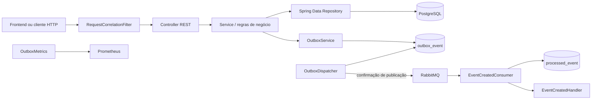
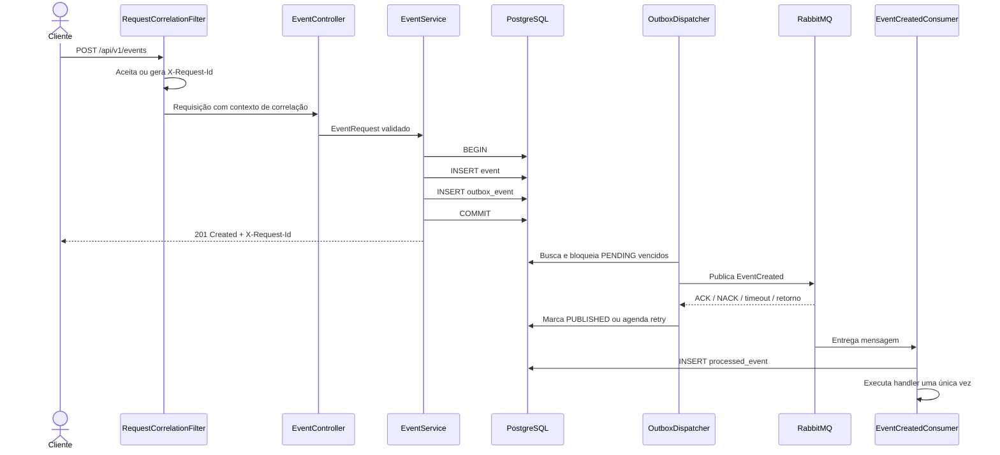
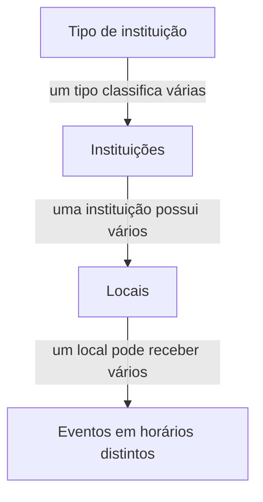
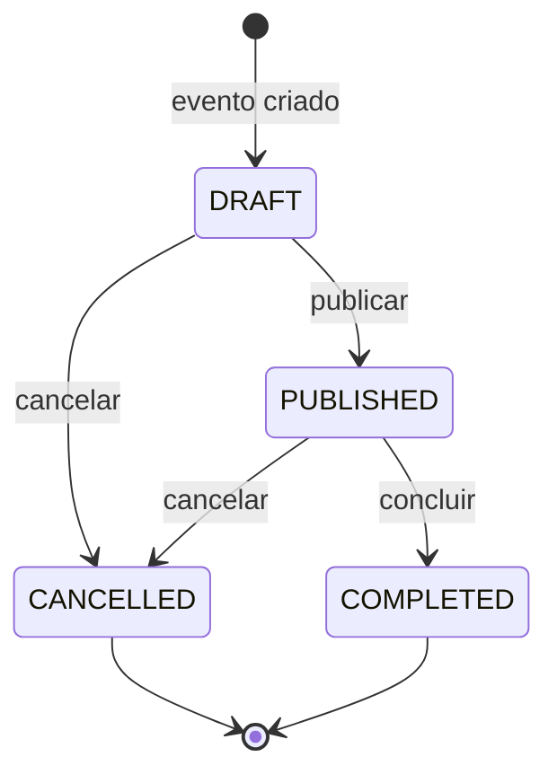
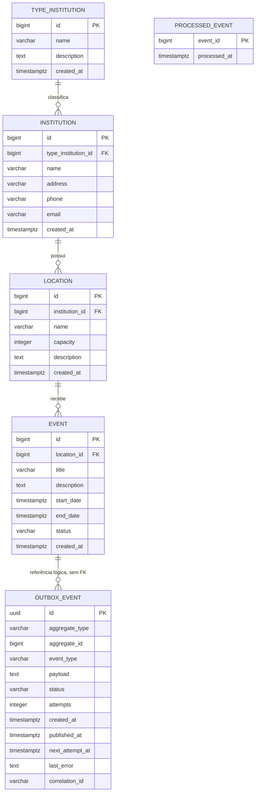
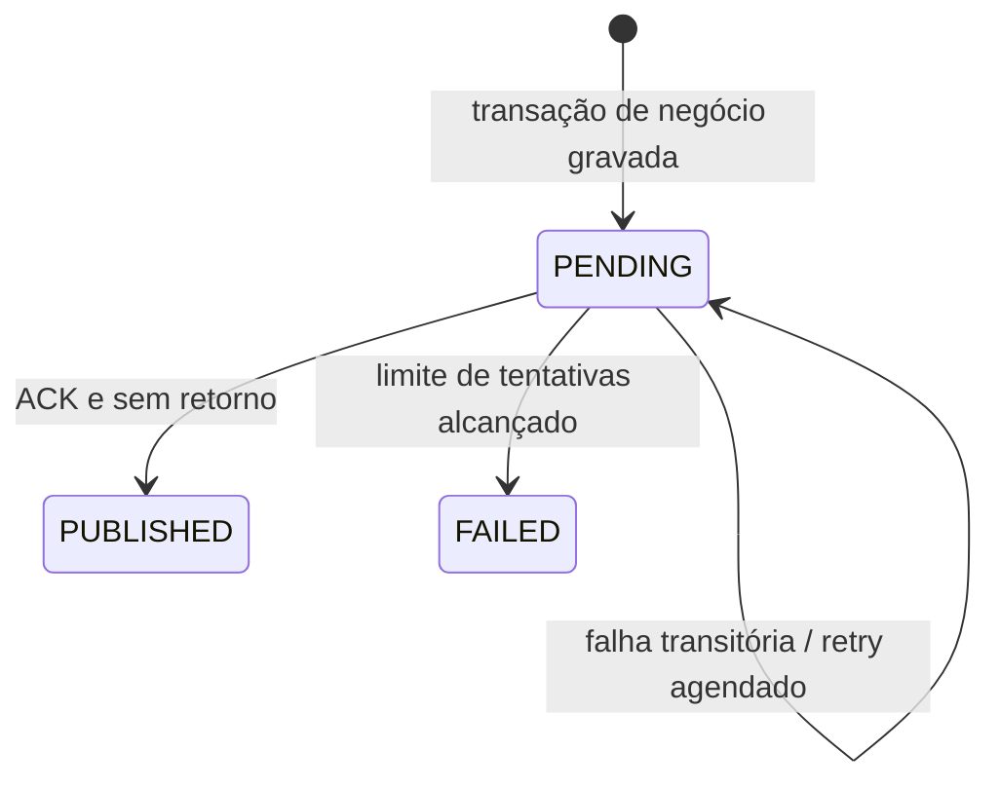

# Backend — Event Manager

Este documento apresenta o backend do Event Manager com linguagem técnica. Ele explica
como uma chamada atravessa as camadas da aplicação, quais regras são aplicadas,
como os dados são modelados, para que servem as anotações e como a confiabilidade
foi construída.

> **Escopo:** esta documentação descreve o código existente em `backend/`.
> Endpoints e integrações que ainda não existem são identificados como evolução,
> não como funcionalidades disponíveis.

## Índice

- [O que o backend faz](#o-que-o-backend-faz)
- [Como entender o fluxo](#como-entender-o-fluxo)
- [Como o backend foi organizado](#como-o-backend-foi-organizado)
- [Regras de negócio](#regras-de-negócio)
- [Banco de dados](#banco-de-dados)
- [API HTTP](#api-http)
- [Anotações usadas nas classes](#anotações-usadas-nas-classes)
- [Outbox, RabbitMQ e confiabilidade](#outbox-rabbitmq-e-confiabilidade)
- [Operação e configurações](#operação-e-configurações)
- [Como executar e testar](#como-executar-e-testar)
- [Pontos de evolução](#pontos-de-evolução)

## O que o backend faz

O backend é uma API REST escrita em Java com Spring Boot. Ele oferece operações
para gerenciar:

1. **Tipos de instituição**, como uma categoria de cadastro.
2. **Instituições**, que pertencem a um tipo.
3. **Locais**, que pertencem a uma instituição.
4. **Eventos**, que ocupam um intervalo de tempo em um local.

O PostgreSQL guarda o estado principal. Quando um evento é criado, o backend
também registra uma mensagem na tabela Outbox, na mesma transação que grava o
evento. Um processo em segundo plano publica essa mensagem no RabbitMQ. O
consumidor recebe `EventCreated`, evita processar o mesmo ID mais de uma vez e
encaminha o trabalho para um handler.



## Como entender o fluxo

### Exemplo: cadastrar um evento

Imagine que o frontend envie `POST /api/v1/events` com título, horário, local e
status.

1. **Correlação:** `RequestCorrelationFilter` verifica o header
   `X-Request-Id`. Se estiver ausente ou fora do formato permitido, gera um
   UUID. Esse valor fica no MDC (contexto de log) durante a requisição.
2. **Entrada HTTP:** `EventController` converte o JSON em `EventRequest`.
   `@Valid` aplica as validações declaradas no DTO.
3. **Regra de negócio:** `EventService` confirma que as datas são válidas, que
   o local existe e que não há conflito de agenda.
4. **Persistência principal:** o service salva a entidade `Event`.
5. **Registro da mensagem:** ainda na mesma transação, `OutboxService` serializa
   o `EventCreated` e salva um registro `PENDING` em `outbox_event`, com o
   mesmo request ID quando disponível.
6. **Commit:** o evento e a mensagem Outbox são confirmados juntos. Se qualquer
   etapa da transação falhar, nenhum dos dois fica gravado.
7. **Publicação:** em uma execução posterior, `OutboxDispatcher` seleciona
   mensagens vencidas, publica no RabbitMQ e aguarda confirmação.
8. **Consumo:** `EventCreatedConsumer` tenta inserir o ID em
   `processed_event`. Se o ID já existir, considera a mensagem duplicada e não
   chama o handler novamente.
9. **Resposta:** o controller devolve `201 Created` com o DTO do evento e o
   filtro adiciona `X-Request-Id` à resposta.

O pedido HTTP não espera a publicação RabbitMQ. A API pode responder após a
transação PostgreSQL; o dispatcher cuida da publicação assíncrona.



## Como o backend foi organizado

O código é separado por domínio. Dentro de cada domínio, as classes têm
responsabilidades específicas. Essa organização ajuda a localizar uma regra e
evita misturar HTTP, persistência e integração com broker em um único método.

### As camadas em linguagem simples

| Camada | Pergunta que responde | Exemplo |
| --- | --- | --- |
| Controller | “Qual URL e método HTTP acionam esta operação?” | `EventController` |
| DTO | “Quais campos entram e saem da API?” | `EventRequest`, `EventResponse` |
| Service | “Quais regras precisam ser cumpridas?” | `EventService` |
| Entity | “Como este conceito fica representado no banco?” | `Event` |
| Repository | “Como buscar e salvar esses dados?” | `EventRepository` |
| Configuração | “Como ligar a aplicação a uma infraestrutura?” | `RabbitMQConfig` |
| Mensageria | “Como publicar e processar mensagens?” | `OutboxDispatcher`, `EventCreatedConsumer` |
| Compartilhado | “Como padronizar comportamentos usados por vários domínios?” | paginação e tratamento de erros |

O caminho comum de leitura é:

```text
HTTP request
  -> Controller
  -> Service
  -> Repository
  -> Entity / PostgreSQL
  -> DTO de resposta
  -> HTTP response
```

### Organização dos pacotes

```text
src/main/java/br/com/formentini/eventManager/
├── EventManagerApplication.java
├── config/
│   ├── RabbitMQConfig.java
│   └── RequestCorrelationFilter.java
├── event/
│   ├── Event.java
│   ├── EventController.java
│   ├── EventRepository.java
│   ├── EventService.java
│   ├── EventScheduleConflictException.java
│   ├── dto/
│   ├── enums/
│   └── messaging/
├── institution/
│   ├── Institution.java
│   ├── InstitutionController.java
│   ├── InstitutionRepository.java
│   ├── InstitutionService.java
│   └── dto/
├── institutiontype/
│   ├── TypeInstitution.java
│   ├── TypeInstitutionController.java
│   ├── TypeInstitutionRepository.java
│   ├── TypeInstitutionService.java
│   └── dto/
├── location/
│   ├── Location.java
│   ├── LocationController.java
│   ├── LocationRepository.java
│   ├── LocationService.java
│   └── dto/
├── outbox/
│   ├── OutboxEvent.java
│   ├── OutboxEventRepository.java
│   ├── OutboxService.java
│   ├── OutboxDispatcher.java
│   ├── OutboxMetrics.java
│   └── enums/
└── shared/
    ├── exception/
    └── pagination/
```

Em termos gerais, o backend foi construído ao redor de três preocupações:

1. **Modelar os cadastros e suas relações** com entidades, chaves estrangeiras
   e migrations.
2. **Concentrar decisões de negócio** nos services e nas próprias entidades
   quando a regra pertence ao estado do objeto, como as transições de status.
3. **Tornar efeitos externos resilientes** usando Outbox, confirmação do broker,
   retries, idempotência e métricas.

Esse desenho separa responsabilidades de modo que cada etapa tenha uma
fronteira clara: controller traduz HTTP, service coordena o caso de uso,
repository conversa com o banco, e componentes de mensageria cuidam do broker.
As dependências são fornecidas por construtor, o que torna explícito o que uma
classe precisa para funcionar e permite substituir dependências por mocks nos
testes unitários.

### Classes para navegar pelo código

| Classe | Papel no fluxo |
| --- | --- |
| `EventManagerApplication` | Inicia o Spring Boot e a descoberta de componentes. |
| `EventController` | Expõe endpoints HTTP de eventos e aplica `@Valid` nos requests. |
| `EventService` | Coordena criação, edição, status, agenda, persistência e Outbox. |
| `Event` | Representa um evento e protege suas transições de status. |
| `EventRepository` | Busca eventos, pagina resultados e verifica conflitos de horário. |
| `OutboxService` | Serializa e persiste a mensagem dentro da transação do caso de uso. |
| `OutboxEventRepository` | Localiza mensagens elegíveis e bloqueia linhas durante o dispatch. |
| `OutboxDispatcher` | Agenda tentativas, publica no RabbitMQ e verifica confirms/returns. |
| `EventCreatedConsumer` | Recebe mensagens, verifica idempotência e mede resultados. |
| `EventCreatedHandler` | Executa o processamento da mensagem; hoje registra o evento em log. |
| `RabbitMQConfig` | Declara exchanges, filas, bindings, DLQ e conversor JSON. |
| `RequestCorrelationFilter` | Cria/valida o request ID e o mantém no contexto de log. |
| `OutboxMetrics` | Publica gauges e counters para Micrometer/Prometheus. |
| `GlobalExceptionHandler` | Converte exceções em respostas HTTP consistentes. |
| `PageableFactory`, `PageResponse` | Validam paginação e definem o formato das páginas HTTP. |

## Regras de negócio

### Relação entre os cadastros



- A instituição precisa referenciar um tipo existente.
- O local precisa referenciar uma instituição existente.
- O evento precisa referenciar um local existente.
- Os vínculos são obrigatórios no banco.
- Não é permitido excluir uma entidade pai enquanto existirem filhos
  vinculados. A API responde `409 Conflict` se a restrição de integridade for
  violada.
- Consultas filtradas verificam se o pai existe. Por exemplo, consultar locais
  de uma instituição inexistente retorna `404`, não uma lista vazia.

### Regras de evento

Os status possíveis são `DRAFT`, `PUBLISHED`, `CANCELLED` e `COMPLETED`.



Regras adicionais:

- A data/hora final deve ser **posterior** à data/hora inicial.
- Eventos `DRAFT` e `PUBLISHED` reservam a agenda do local.
- Eventos `CANCELLED` e `COMPLETED` deixam de reservar aquele horário.
- Dois eventos ativos não podem se sobrepor no mesmo local.
- A rota `PUT /events/{id}` altera os dados do evento, mas não altera seu
  status; a mudança de status é feita por `PATCH /events/{id}/status`.
- Eventos em locais diferentes podem ocorrer ao mesmo tempo.
- Os intervalos são tratados como `[início, fim)`: o fim não faz parte do
  intervalo ocupado. Portanto, um evento pode começar exatamente quando o
  anterior termina.
- Um evento `CANCELLED` ou `COMPLETED` é terminal: não pode ser editado nem ter
  o status alterado.
- Um evento `PUBLISHED` pode ter título, descrição, horário ou local editados,
  mas não pode voltar para `DRAFT`.
- A criação do evento produz `EventCreated` para o Outbox, inclusive se o
  evento for inicialmente criado como `DRAFT`.

As regras são checadas em mais de uma camada:

1. **DTO/Bean Validation:** formato, campos obrigatórios, tamanho e números
   positivos.
2. **Service/domain:** dependências existentes, fim posterior ao início,
   estados permitidos e pré-checagem de agenda.
3. **PostgreSQL:** FKs, checks e constraint de exclusão que protegem também
   contra duas requisições concorrentes.

O banco é a última proteção para integridade compartilhada: duas requisições
podem passar por uma pré-checagem quase ao mesmo tempo, mas a constraint GiST
impede que ambas confirmem intervalos conflitantes.

**Detalhe da implementação atual:** a pré-checagem do service compara o pedido
com eventos já ativos. Na criação, ela é executada mesmo se o novo evento vier
como `CANCELLED` ou `COMPLETED`; portanto, a API pode responder `409 Conflict`
se esse pedido ocupar o horário de um evento ativo. A constraint GiST do banco,
por sua vez, só impede sobreposição quando o registro persistido está em
`DRAFT` ou `PUBLISHED`. Essa diferença entre a pré-checagem e a constraint é um
ponto de atenção para uma evolução das regras.

## Banco de dados

As migrations ficam em `src/main/resources/db/migration`. O Flyway aplica as
migrations em ordem e registra as versões já aplicadas. O Hibernate usa
`spring.jpa.hibernate.ddl-auto=validate`: ele verifica se as entidades
correspondem ao esquema, mas não cria nem atualiza tabelas automaticamente.

### Diagrama relacional



`outbox_event` não tem uma FK para `event`: o Outbox é genérico e identifica o
registro associado por `aggregate_type` e `aggregate_id`. Por outro lado,
`processed_event.event_id` é a chave primária que garante uma única marca de
processamento por ID de evento.

### Tabelas

| Tabela | Campos e propósito |
| --- | --- |
| `type_institution` | `id` identity, `name` obrigatório até 100 caracteres, `description` opcional e `created_at`. |
| `institution` | `id`, `type_institution_id` obrigatório, `name` obrigatório até 150, `address` até 300, `phone` até 50, `email` até 254 e `created_at`. |
| `location` | `id`, `institution_id` obrigatório, `name` até 150, `capacity` obrigatório com padrão 0 e não negativo, `description` e `created_at`. |
| `event` | `id`, `location_id` obrigatório, `title` até 200 no banco, `description`, `start_date`, `end_date`, `status` e `created_at`. |
| `outbox_event` | UUID `id`, `aggregate_type`, `aggregate_id`, `event_type`, payload JSON em texto, status, número de tentativas, datas de criação/publicação/próxima tentativa, último erro e `correlation_id`. |
| `processed_event` | `event_id` como PK e horário `processed_at`; é a trava de idempotência do consumer. |

As tabelas de instituição, local e evento têm FKs com `ON DELETE RESTRICT`.
Isso evita que a remoção de um tipo apague instituições, que a remoção de uma
instituição apague locais ou que a remoção de um local apague eventos de forma
implícita.

### Constraints e índices importantes

- `chk_event_dates`: impede término anterior ao início. A regra de aplicação é
  mais estrita e exige término posterior.
- `chk_event_status`: limita o status aos quatro valores conhecidos.
- `chk_location_capacity`: impede capacidade negativa.
- `ck_outbox_event_status`: limita estado a `PENDING`, `PUBLISHED` ou `FAILED`.
- `ck_outbox_event_attempts`: impede contagem de tentativas negativa.
- `exclusion_event_location_active_times`: impede intervalos ativos
  sobrepostos no mesmo local. Usa a extensão PostgreSQL `btree_gist` e ranges
  semiabertos `[)`.
- Índice do Outbox `(status, next_attempt_at, created_at)`: ajuda a localizar
  rapidamente mensagens elegíveis para envio.
- Índices em FKs e datas/status de evento ajudam nas relações e consultas
  frequentes.

### Histórico de migrations

| Arquivo | Evolução do esquema |
| --- | --- |
| `V1__create_initial_tables.sql` | Cria tabelas principais, FKs, checks e índices iniciais; também cria a tabela Outbox. |
| `V2__outbox_and_event_integrity.sql` | Cria `processed_event` e a constraint PostgreSQL para impedir sobreposição de eventos ativos. |
| `V3__complete_frontend_fields.sql` | Adiciona descrições, contatos, capacidade e check de capacidade. |
| `V4__outbox_correlation_id.sql` | Adiciona `correlation_id` na tabela Outbox. |

## API HTTP

Todos os recursos começam por `/api/v1`.

| Recurso | Operações |
| --- | --- |
| Tipos de instituição | `GET /institution-types`, `GET /institution-types/{id}`, `POST /institution-types`, `PUT /institution-types/{id}`, `DELETE /institution-types/{id}` |
| Instituições | `GET /institutions`, `GET /institutions/{id}`, `GET /institutions/type/{typeInstitutionId}`, `POST /institutions`, `PUT /institutions/{id}`, `DELETE /institutions/{id}` |
| Locais | `GET /locations`, `GET /locations/{id}`, `GET /locations/institution/{institutionId}`, `POST /locations`, `PUT /locations/{id}`, `DELETE /locations/{id}` |
| Eventos | `GET /events`, `GET /events/{id}`, `GET /events/location/{locationId}`, `POST /events`, `PUT /events/{id}`, `PATCH /events/{id}/status`, `DELETE /events/{id}` |

### Paginação

As listagens aceitam `page`, `size`, `sort` e `direction`.

- `page=0` e `size=20` são os padrões.
- `page` não pode ser negativo.
- `size` precisa estar entre 1 e 100.
- `direction` aceita `asc` ou `desc`.
- O campo de ordenação é validado por recurso; não se aceita nome de coluna
  arbitrário.
- O campo `id ASC` é acrescentado como desempate quando a ordenação principal
  não é `id`, tornando páginas mais estáveis.
- A resposta informa `content`, `page`, `size`, `totalElements`, `totalPages`,
  `first` e `last`.

`PageableFactory` concentra a validação e a criação do `Pageable`; `PageResponse`
converte o resultado do Spring Data no contrato HTTP que o frontend consome.

### Status e formato de erro

| HTTP | Significado |
| --- | --- |
| `200` | Leitura ou atualização concluída. |
| `201` | Recurso criado. |
| `204` | Exclusão concluída sem corpo. |
| `400` | DTO inválido, JSON ilegível, parâmetro inválido ou regra de transição/datas. |
| `404` | Recurso ou entidade relacionada não existe. |
| `409` | Conflito de agenda ou violação de integridade referencial. |
| `500` | Erro não previsto; detalhes técnicos são registrados no backend, não devolvidos ao cliente. |

Os erros são representados como JSON com a propriedade `error`. A classe
`GlobalExceptionHandler` mapeia exceções da aplicação e de validação para esses
status.

## Anotações usadas nas classes

Anotações são metadados lidos pelo Spring, JPA, Hibernate ou Jakarta Validation.
Em termos simples, elas informam ao framework como tratar uma classe ou
propriedade, reduzindo código repetitivo.

### Persistência JPA — entidades

Exemplo de declaração no `Event.java`:

```java
@Entity
@Table(name = "event")
public class Event {
    @Id
    @GeneratedValue(strategy = GenerationType.IDENTITY)
    private Long id;

    @ManyToOne(fetch = FetchType.LAZY, optional = false)
    @JoinColumn(name = "location_id", nullable = false)
    private Location location;
}
```

| Anotação | O que significa no projeto |
| --- | --- |
| `@Entity` | A classe representa um registro que o JPA pode carregar e salvar. |
| `@Table(name = "...")` | Define explicitamente o nome SQL da tabela. |
| `@Id` | Marca a chave primária. |
| `@GeneratedValue(strategy = IDENTITY)` | Pede ao banco para gerar o ID identity. |
| `@ManyToOne` | Vários registros podem apontar para uma mesma entidade pai. Evento→local, local→instituição e instituição→tipo. |
| `fetch = LAZY` | Tenta carregar a relação somente quando ela é necessária, em vez de sempre trazer toda a hierarquia. |
| `optional = false` | A associação é obrigatória no modelo JPA. |
| `@JoinColumn` | Configura a coluna usada para a FK, como `location_id`. |
| `@Column` | Define detalhes da coluna: tamanho, nulabilidade, nome, tipo ou participação em INSERT/UPDATE. |
| `@Enumerated(EnumType.STRING)` | Salva o nome do status (`PUBLISHED`) em vez do número/posição do enum. |
| `@CreationTimestamp` | Preenche automaticamente a data de criação pelo Hibernate. |

As entidades têm construtor sem argumentos `protected` porque o JPA precisa
instanciá-las ao ler o banco. Construtores públicos e métodos de domínio são
usados pelo restante da aplicação.

`@CreationTimestamp` não significa que toda coluna tem exatamente o mesmo
mapeamento: algumas entidades declaram `insertable=false, updatable=false`,
deixando a coluna controlada pelo default do banco; `TypeInstitution` declara
o timestamp não atualizável. A migration também define defaults SQL.

### Spring MVC — controllers

Exemplo simplificado:

```java
@RestController
@RequestMapping("/api/v1/events")
public class EventController {
    @PostMapping
    @ResponseStatus(HttpStatus.CREATED)
    public EventResponse create(@Valid @RequestBody EventRequest request) {
        return eventService.create(request);
    }
}
```

| Anotação | Uso |
| --- | --- |
| `@RestController` | Declara uma classe de endpoints que escreve objetos como resposta HTTP (normalmente JSON). |
| `@RequestMapping` | Define o prefixo comum dos caminhos do controller. |
| `@GetMapping`, `@PostMapping`, `@PutMapping`, `@PatchMapping`, `@DeleteMapping` | Associam método Java e verbo HTTP a uma operação. |
| `@RequestBody` | Converte o JSON da requisição para o DTO correspondente. |
| `@PathVariable` | Lê um valor da URL, por exemplo o ID em `/events/{id}`. |
| `@RequestParam` | Lê parâmetros da query string, como `page` e `size`. |
| `@ResponseStatus` | Define o status HTTP fixo de uma operação, como `201` ou `204`. |
| `@Valid` | Executa as constraints declaradas no DTO antes de invocar a regra do service. |

### Validação Jakarta — DTOs

Os DTOs são `record`s: estruturas imutáveis e compactas para receber ou devolver
dados. Eles mantêm o contrato da API separado das entidades persistidas.

| Constraint | Validação |
| --- | --- |
| `@NotNull` | O campo precisa ter valor. |
| `@NotBlank` | Texto não pode ser nulo, vazio ou conter apenas espaços. |
| `@Size(max = ...)` | Limita o tamanho de texto. |
| `@Positive` | Número deve ser maior que zero. |
| `@PositiveOrZero` | Número pode ser zero, mas não negativo. |
| `@Email` | Valida o formato de e-mail. |

Exemplos nos arquivos:

- `TypeInstitutionRequest`: nome obrigatório até 100 caracteres; descrição até
  2.000.
- `InstitutionRequest`: nome obrigatório, ID de tipo positivo e e-mail com
  formato válido.
- `LocationRequest`: nome e instituição obrigatórios; capacidade não negativa.
- `EventRequest`: título, início, fim, local positivo e status obrigatórios.
  A comparação entre datas fica no service, e não numa constraint de campo.

Essas anotações validam o formato/valor do pedido. A existência real do ID
referenciado é verificada no service e protegida também pela FK do banco.

### Injeção e componentes Spring

| Anotação/mecanismo | Uso |
| --- | --- |
| `@SpringBootApplication` | Ponto de entrada da aplicação; ativa configuração automática e descoberta dos componentes Spring. |
| `@Service` | Registra uma classe de lógica de aplicação, como `EventService`. |
| `@Component` | Registra um componente genérico do Spring, como filter, consumer, dispatcher ou métricas. |
| `@Configuration` | Marca uma classe de configuração explícita. |
| `@Bean` | Registra como bean o objeto retornado pelo método, usado para exchange, fila, binding ou conversor. |
| Injeção por construtor | O Spring fornece as dependências no construtor; deixa explícito do que cada classe precisa e facilita testes. |
| `@Value("${...}")` | Lê valores de configuração e permite defaults, como quantidade do lote do Outbox. |
| `@Order(Ordered.HIGHEST_PRECEDENCE)` | Coloca o filtro de request ID no início da cadeia de filtros servlet. |
| `OncePerRequestFilter` | Evita executar o filtro mais de uma vez na mesma requisição servlet. |

### Transações

| Uso | Efeito |
| --- | --- |
| `@Transactional` | Executa operações de escrita dentro de uma transação. Se uma exceção aplicável sair do método, o Spring reverte a transação. |
| `@Transactional(readOnly = true)` | Marca consultas como somente leitura e permite otimizações do provider. |
| `@Transactional(propagation = MANDATORY)` | Em `OutboxService.save`, exige que já exista uma transação; falha se alguém tentar salvar o Outbox isoladamente. |

O limite transacional é importante em `EventService.create`: a gravação do
evento e a do Outbox compartilham o mesmo commit. Uma chamada ao broker não é
realizada dentro da transação HTTP.

### Spring Data e consultas

| Anotação/mecanismo | Efeito |
| --- | --- |
| `JpaRepository<Entity, Id>` | Fornece operações comuns de CRUD, paginação e persistência sem precisar escrever implementação à mão. |
| Métodos derivados, por exemplo `findByInstitutionId` | Spring cria a consulta a partir do nome e da assinatura do método. |
| `@Query` | Permite declarar JPQL específica para regras como sobreposição de horário ou soma de tentativas. |
| `@Param` | Liga o argumento Java a um parâmetro nomeado na consulta. |
| `@Lock(LockModeType.PESSIMISTIC_WRITE)` | Pede bloqueio de escrita ao banco para coordenar dispatchers concorrentes que selecionam a mesma mensagem. |

### Mensageria, tarefas e exceções

| Anotação | Uso |
| --- | --- |
| `@Scheduled(fixedDelayString = "...")` | Executa periodicamente a busca e publicação de mensagens Outbox. A espera ocorre entre execuções. |
| `@RabbitListener(queues = "...")` | Registra um método como consumidor da fila RabbitMQ. |
| `@Header` | Lê metadados do envelope da mensagem, como o correlation ID. |
| `@RestControllerAdvice` | Registra tratamento global de exceções MVC. |
| `@ExceptionHandler` | Associa tipos de exceção a respostas/status HTTP. |

## Outbox, RabbitMQ e confiabilidade

### Por que existe o Outbox

Um padrão simples — gravar no banco e depois publicar diretamente no broker —
tem uma janela de falha:

```text
Banco confirma o evento
        |
        +-- processo cai antes de publicar --> consumidor nunca é avisado
```

O Outbox resolve esse problema persistindo a intenção de publicar na mesma
transação do dado de domínio. Um componente separado publica essa intenção mais
tarde. Assim, se o RabbitMQ estiver fora do ar, o registro fica no banco e pode
ser tentado novamente.

### Estados da mensagem Outbox



`FAILED` mantém o registro para análise. Não há endpoint administrativo de
replay no momento.

### Envio e confirmações

`OutboxDispatcher`:

1. Busca registros `PENDING` cujo `next_attempt_at` chegou, por ordem de criação.
2. Limita quantos carrega por lote.
3. Bloqueia a seleção com `PESSIMISTIC_WRITE`.
4. Desserializa os eventos suportados (atualmente `EventCreated`).
5. Publica em `event.exchange` com routing key `event.created.v1`.
6. Aguarda confirmação correlacionada.
7. Só marca `PUBLISHED` se recebeu ACK e a mensagem não foi retornada por falta
   de rota.
8. Para NACK, retorno, timeout ou erro, incrementa tentativas e agenda retry.
9. Após o número máximo configurado, marca `FAILED`.

Valores padrão, todos sobrescrevíveis por propriedade:

| Propriedade | Padrão | Significado |
| --- | ---: | --- |
| `outbox.dispatcher.fixed-delay-ms` | `1000` | Intervalo entre varreduras. |
| `outbox.dispatcher.batch-size` | `100` | Máximo de mensagens por lote. |
| `outbox.dispatcher.max-attempts` | `5` | Tentativas até o estado `FAILED`. |
| `outbox.dispatcher.confirmation-timeout-ms` | `10000` | Tempo de espera pelo confirm. |
| `outbox.dispatcher.retry-initial-delay-ms` | `1000` | Base do backoff exponencial. |
| `outbox.dispatcher.retry-max-delay-ms` | `60000` | Limite do intervalo de retry. |

O cálculo do retry dobra o intervalo entre tentativas até o teto configurado.
`last_error` guarda uma descrição útil; se uma exceção não trouxer mensagem, o
dispatcher registra o tipo da exceção.

### Consumer e idempotência

`EventCreatedConsumer` recebe a mensagem e usa `processed_event` como registro
de idempotência. A inserção usa `ON CONFLICT DO NOTHING`:

- Inserção nova: o consumer executa `EventCreatedHandler`.
- ID já registrado: trata como duplicata e retorna sem executar o handler.
- Exceção de processamento: a transação é revertida e a falha é relançada
  para o mecanismo de retry do listener.

O registro de processamento e o trabalho do handler são parte da mesma
transação, para que uma falha não deixe o ID marcado como concluído antes do
processamento.

### Topologia e DLQ

`RabbitMQConfig` declara:

| Recurso RabbitMQ | Nome | Papel |
| --- | --- | --- |
| Topic exchange | `event.exchange` | Recebe o evento publicado pelo dispatcher. |
| Fila principal | `event.created.queue` | Recebe `EventCreated`. |
| Routing key principal | `event.created.v1` | Direciona a mensagem à fila principal. |
| Dead-letter exchange | `event.dlx` | Recebe mensagens rejeitadas definitivamente. |
| Dead-letter queue | `event.created.dlq` | Armazena mensagens não processadas. |
| Routing key DLQ | `event.created.failed` | Direciona a mensagem ao destino morto. |

A fila principal é durável e configurada sem requeue para mensagens rejeitadas.
O retry local do listener usa:

| Propriedade Spring AMQP | Padrão |
| --- | ---: |
| `spring.rabbitmq.listener.simple.retry.enabled` | `true` |
| `spring.rabbitmq.listener.simple.retry.max-attempts` | `3` |
| `spring.rabbitmq.listener.simple.retry.initial-interval` | `1000ms` |
| `spring.rabbitmq.listener.simple.retry.multiplier` | `2.0` |
| `spring.rabbitmq.listener.simple.retry.max-interval` | `10000ms` |
| `spring.rabbitmq.listener.simple.default-requeue-rejected` | `false` |

Depois que os retries locais falham, a mensagem é roteada para a DLQ. O Outbox
e o retry do consumidor são mecanismos diferentes: o primeiro protege a
publicação; o segundo protege o processamento.

## Operação e configurações

### Configuração por ambiente

Arquivos principais:

- `src/main/resources/application.properties`: configuração padrão e valores
  de desenvolvimento local.
- `src/main/resources/application-prod.properties`: ajustes do perfil de
  produção, incluindo logs JSON e uso de variáveis obrigatórias para conexões.
- `compose.yaml`: PostgreSQL e RabbitMQ de desenvolvimento.
- `Dockerfile`: build Maven em Java 21 e execução em uma imagem JRE menor.

Variáveis de ambiente mais comuns:

| Variável | Uso |
| --- | --- |
| `DB_URL` | URL JDBC do PostgreSQL. |
| `DB_USERNAME`, `DB_PASSWORD` | Credenciais do banco. |
| `RABBITMQ_HOST`, `RABBITMQ_PORT` | Endereço e porta AMQP. |
| `RABBITMQ_USERNAME`, `RABBITMQ_PASSWORD` | Credenciais RabbitMQ. |
| `SPRING_PROFILES_ACTIVE=prod` | Ativa configurações de produção. |

Não reutilize credenciais padrão de desenvolvimento em produção. Armazene
secrets num serviço de secrets ou mecanismo seguro do ambiente.

### Request ID e logs

O filtro:

- aceita IDs no padrão `[A-Za-z0-9._-]{1,64}`;
- substitui valores ausentes ou inseguros por UUID;
- responde com `X-Request-Id`;
- expõe `requestId` no MDC enquanto a chamada HTTP está em execução;
- registra método, caminho, status e duração;
- limpa o MDC ao sair, mesmo se ocorrer exceção.

O Outbox persiste o ID e o dispatcher transporta-o no header de correlação da
mensagem. O consumer recoloca o ID no MDC. Sem ID HTTP, usa-se o UUID do Outbox;
sem header de correlação na mensagem, o consumer usa o ID do evento.

### Métricas

`OutboxMetrics` registra métricas Micrometer:

| Métrica Prometheus | O que informa |
| --- | --- |
| `event_outbox_pending` | Quantidade atual de mensagens pendentes. |
| `event_outbox_failed` | Quantidade de mensagens que esgotaram tentativas. |
| `event_outbox_pending_attempts` | Soma das tentativas de mensagens pendentes. |
| `event_outbox_oldest_pending_seconds` | Idade da mensagem pendente mais antiga. |
| `event_outbox_publish_total{result=...}` | Publicações com resultado success/failure. |
| `event_consumer_messages_total{result=...}` | Processadas, duplicadas ou falhas do consumer. |
| `event_rabbitmq_dlq_messages` | Profundidade da DLQ; `-1` significa que a leitura não está disponível. |

Endpoint: `GET /actuator/prometheus`. Health: `GET /actuator/health`.
Detalhes internos do health ficam ocultos pela configuração.

## Como executar e testar

### Dependências

- Java 21 para desenvolvimento/execução local.
- Docker disponível para os testes de integração com Testcontainers.
- PostgreSQL e RabbitMQ para testes/contextos que usam os endereços definidos
  na configuração padrão.

### Subir dependências

A partir da raiz do repositório:

```sh
docker compose -f backend/compose.yaml up -d
```

O Compose de desenvolvimento usa os nomes:

- PostgreSQL: `localhost:5433`, database `event_manager`.
- RabbitMQ AMQP: `localhost:5672`.
- RabbitMQ Management UI: `http://localhost:15672`.

Credenciais padrão de desenvolvimento ficam declaradas em `compose.yaml`.
Não as utilize num ambiente exposto.

### Executar a API

PowerShell:

```powershell
cd backend
.\mvnw.cmd spring-boot:run
```

POSIX:

```sh
cd backend
./mvnw spring-boot:run
```

A aplicação fica em `http://localhost:8080`; health em
`http://localhost:8080/actuator/health`.

### Executar os testes

Na pasta `backend`:

```powershell
.\mvnw.cmd test
```

Ou no POSIX:

```sh
./mvnw test
```

`verify` também executa as fases de verificação configuradas e gera o relatório
JaCoCo:

```sh
./mvnw verify
```

Alguns testes iniciam containers de PostgreSQL/RabbitMQ com Testcontainers;
outros contextos usam `application.properties`. Por isso, para executar a suíte
completa localmente, deixe acessíveis os serviços de desenvolvimento acima,
além do Docker para Testcontainers.

### O que os testes verificam

| Grupo de teste | Exemplos de comportamento coberto |
| --- | --- |
| Controller | Status HTTP, formato de resposta, validação de payload e parâmetros. |
| Service | CRUD, relações, recursos não encontrados e regras de status/agendamento. |
| Repository | Consultas, paginação, persistência e integridade PostgreSQL. |
| API de integração | Requisições HTTP completas passando pelo Spring e banco real. |
| Event reliability | Transação evento+Outbox, corrida por reserva do mesmo horário e restrições de exclusão. |
| Outbox service | Serialização, correlação, persistência, falha de serialização e exigência de transação. |
| Outbox dispatcher | ACK, NACK, retorno, timeout, backoff, limite, recuperação e concorrência de dispatchers. |
| RabbitMQ | Publicação, confirmação e retorno de mensagens sem rota. |
| Consumer | Processamento, duplicidade, retries, correlation ID, DLQ e JSON inválido. |
| Métricas | Counters/gauges, DLQ ausente, RabbitAdmin ausente ou broker indisponível. |
| Filtro HTTP | ID seguro, inválido ou ausente, resposta, MDC e limpeza após exceção. |

Relatórios JaCoCo ficam em:

```text
target/site/jacoco/index.html
target/site/jacoco/jacoco.xml
```

Os testes do frontend ficam fora do escopo deste módulo; o workflow de CI
constrói o frontend, mas atualmente não executa uma suíte automatizada de
componentes/browser.

## Pontos de evolução

- **Autenticação e autorização:** a API atual não inclui um mecanismo próprio
  de autenticação/autorização. Proteger operações antes de disponibilizar o
  backend publicamente.
- **Replay administrativo:** não há endpoint para reprocessar `FAILED` ou
  mensagens da DLQ; hoje isso requer procedimento operacional controlado.
- **Efeitos de negócio do consumer:** `EventCreatedHandler` atualmente registra
  o processamento em log. E-mail, notificações e integrações externas são
  trabalho futuro.
- **Alertas:** existem métricas e regras Prometheus, mas encaminhar alertas
  requer Alertmanager/receptores no ambiente.
- **Performance:** não há suíte de carga configurada; thresholds devem ser
  definidos de acordo com capacidade e SLOs esperados.
