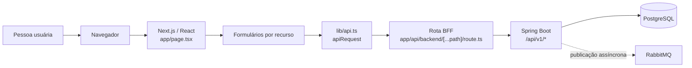
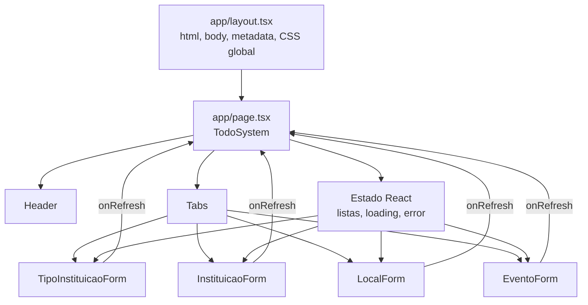
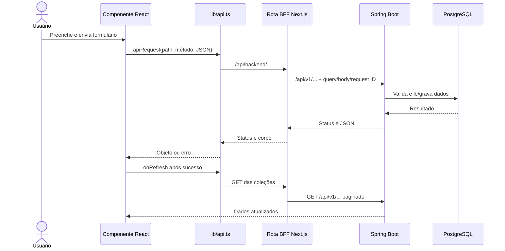

# Frontend — Event Manager

Este documento apresenta o frontend do Event Manager de forma técnica, mas
acessível. Ele explica como a interface foi organizada, como os componentes
trocam dados, como uma interação vira uma chamada HTTP, como o Next.js e o
React montam a página e quais regras são tratadas pela interface.

> **Escopo:** o frontend ativo está em `frontend/app`. A pasta `frontend/src`
> contém código legado/anterior e está excluída da compilação TypeScript atual.
> A documentação descreve o fluxo ativo, não funcionalidades que ainda não
> estão ligadas à aplicação.

## Índice

- [Visão geral](#visão-geral)
- [Tecnologias e conceitos](#tecnologias-e-conceitos)
- [Estrutura de pastas](#estrutura-de-pastas)
- [Como a página é montada](#como-a-página-é-montada)
- [Componentes e comunicação](#componentes-e-comunicação)
- [Fluxo de dados e API](#fluxo-de-dados-e-api)
- [Regras aplicadas pela interface](#regras-aplicadas-pela-interface)
- [Tipos, diretivas e anotações](#tipos-diretivas-e-anotações)
- [Como o HTML e o visual são construídos](#como-o-html-e-o-visual-são-construídos)
- [Tratamento de erros e estados](#tratamento-de-erros-e-estados)
- [Configuração e execução](#configuração-e-execução)
- [Limitações e próximos passos](#limitações-e-próximos-passos)

## Visão geral

O frontend é uma aplicação web construída com Next.js, React e TypeScript. A
tela principal permite cadastrar e consultar:

1. Tipos de instituição.
2. Instituições vinculadas a um tipo.
3. Locais vinculados a uma instituição.
4. Eventos vinculados a um local.

Os quatro cadastros aparecem em abas na mesma página. O estado das listas fica
na página principal; os formulários recebem os dados necessários por
propriedades (props) e comunicam operações ao backend usando uma biblioteca
comum de requisições.

O navegador não chama o endereço do backend diretamente. Ele chama uma rota
local do Next.js, que atua como **BFF** (*Backend for Frontend*): encaminha a
requisição ao Spring Boot e devolve a resposta à interface.



O papel do frontend é apresentar e coletar dados, oferecer feedback de
carregamento/erro e atualizar as listas após operações. Regras de integridade,
permissões de escrita (não implementadas atualmente), transições válidas de
status e persistência continuam sob responsabilidade do backend.

## Tecnologias e conceitos

| Tecnologia/conceito | Papel |
| --- | --- |
| Next.js 15 — App Router | Rotas de página, layout, metadados e rota BFF no servidor Next.js. |
| React 18 | Componentes, estado local e atualização declarativa da interface. |
| TypeScript | Tipos para entidades exibidas, payloads, props e respostas. |
| Tailwind CSS | Classes utilitárias aplicadas diretamente ao JSX para espaçamento, cores e layout. |
| Radix UI | Comportamentos acessíveis para controles como abas e listas de seleção. |
| Componentes no estilo shadcn/ui | Componentes de interface locais e customizáveis em `components/ui`. |
| Lucide React | Ícones SVG usados em títulos, botões e informações dos cadastros. |
| `fetch` | Comunicação HTTP do navegador com o BFF e do BFF com o backend. |

O repositório não configura atualmente um framework de testes de frontend nem
um script `test` no `package.json`. O comando de build do Next.js é a validação
automatizada de produção disponível no pacote.

## Estrutura de pastas

```text
frontend/
├── app/
│   ├── api/backend/[...path]/route.ts  # BFF: encaminha métodos HTTP ao backend
│   ├── components/
│   │   ├── header.tsx                  # Cabeçalho visual
│   │   ├── tipo-instituicao-form.tsx   # Formulário e lista de tipos
│   │   ├── instituicao-form.tsx        # Formulário e lista de instituições
│   │   ├── local-form.tsx              # Formulário e lista de locais
│   │   └── evento-form.tsx             # Formulário e lista de eventos
│   ├── globals.css                     # Tailwind e variáveis de tema
│   ├── layout.tsx                      # Estrutura HTML e metadados globais
│   └── page.tsx                        # Página principal e estado compartilhado
├── components/
│   ├── ui/                             # Botões, cards, abas, inputs, selects etc.
│   └── theme-provider.tsx              # Wrapper de tema disponível
├── hooks/                              # Hooks compartilhados (se aplicável)
├── lib/
│   ├── api.ts                          # Cliente HTTP, erros e paginação
│   └── utils.ts                        # Junção/normalização de classes CSS
├── public/                             # Arquivos estáticos e ícones
├── src/                                # Código anterior/legado, fora da compilação TS
├── Dockerfile                          # Build standalone em estágios Node
├── next.config.mjs                     # Saída standalone do Next.js
├── tailwind.config.ts                  # Tema e caminhos varridos pelo Tailwind
├── tsconfig.json                       # Opções TypeScript e alias @/*
└── package.json                        # Scripts e dependências
```

### Onde começar a leitura

- Para entender a tela e os dados compartilhados, comece em `app/page.tsx`.
- Para seguir uma operação de ponta a ponta, leia um dos formulários e depois
  `lib/api.ts`.
- Para verificar como a chamada chega ao servidor Java, leia
  `app/api/backend/[...path]/route.ts`.
- Para entender o documento HTML, metadados e CSS global, leia
  `app/layout.tsx` e `app/globals.css`.
- Para encontrar um controle visual reutilizável, consulte `components/ui/`.

O alias `@/` é configurado no TypeScript para apontar à raiz de `frontend/`.
Assim, por exemplo, `@/lib/api` referencia `frontend/lib/api.ts`.

## Como a página é montada

### Rota principal e layout

O App Router associa `app/page.tsx` à rota `/`. O arquivo `app/layout.tsx`
envolve a página e define o documento HTML:

- `<html lang="pt-BR">` informa o idioma do documento.
- `<body>` recebe classes tipográficas globais.
- `metadata` configura título, descrição e ícones usados pelo Next.js para
  construir os elementos correspondentes no `<head>`.
- `globals.css` é importado no layout e fornece estilos globais e as diretivas
  do Tailwind.

`layout.tsx` não contém estado de interface nem chamadas de dados; seu papel é
definir o contorno comum do documento. A página implementa o conteúdo da rota.

### Componente da página

`app/page.tsx` contém o componente principal (`TodoSystem`). Ele:

1. Declara os tipos de dados usados pelos quatro recursos.
2. Mantém no React state as listas, o indicador de carregamento e o erro global.
3. Carrega as quatro listas paginadas quando a página é montada no navegador.
4. Converte os objetos da API para os tipos usados pela interface.
5. Desenha o cabeçalho, o título, alertas, abas e os formulários.
6. Passa dados e a função de recarga aos componentes filhos.

As abas são construídas com `Tabs`, `TabsList`, `TabsTrigger` e `TabsContent`.
O estado da aba selecionada é gerenciado pelo componente de abas; a tela
principal fornece a estrutura e os componentes correspondentes.



### Renderização e HTML no navegador

Os arquivos `.tsx` misturam TypeScript e JSX. JSX é uma forma declarativa de
descrever a árvore visual: elementos como `<main>`, `<h1>`, `<form>` e `<button>`
representam estrutura semelhante a HTML; componentes como `<Card>` e `<Tabs>`
são funções React que produzem parte dessa árvore.

No Next.js, a página está marcada como componente cliente. O servidor Next.js
pode produzir HTML inicial para a rota, e o JavaScript correspondente é enviado
ao navegador para a **hidratação**: React conecta eventos e estado à estrutura
renderizada para que os formulários e as abas passem a ser interativos.

O carregamento das listas ocorre em `useEffect`, portanto depois que a página
foi carregada no navegador. Na primeira renderização, as listas começam vazias
e `loading` começa como verdadeiro. Após o carregamento, a página atualiza o
estado e React renderiza novamente com os dados. Ao salvar ou excluir, a mesma
sequência de atualização de estado faz as listas refletirem o backend.

## Componentes e comunicação

### Responsabilidades

| Componente | Responsabilidade |
| --- | --- |
| `TodoSystem` em `app/page.tsx` | Coordena dados compartilhados, carregamento, erro global e abas. |
| `Header` | Apresenta a identidade visual e o cabeçalho; não faz chamadas de API. |
| `TipoInstituicaoForm` | Cria, edita, lista e exclui tipos de instituição. |
| `InstituicaoForm` | Cria, edita, lista e exclui instituições; recebe os tipos para associação. |
| `LocalForm` | Cria, edita, lista e exclui locais; recebe instituições para associação. |
| `EventoForm` | Cria, edita, lista e exclui eventos; recebe locais e instituições para exibição. |
| `components/ui/*` | Fornece primitivas visuais reutilizáveis, como `Button`, `Card`, `Input` e `Tabs`. |

### Props e estado

As listas principais são propriedade de `TodoSystem`. Cada formulário recebe
somente as listas de que precisa e uma callback `onRefresh`:

```tsx
<LocalForm
  locais={locais}
  instituicoes={instituicoes}
  onRefresh={refreshData}
/>
```

Dentro de cada formulário, `useState` guarda o que está sendo digitado, qual
registro está em edição e a mensagem de erro daquela operação. Esses campos
não precisam ser mantidos na página principal, porque só o próprio formulário
os utiliza.

O fluxo de comunicação é intencionalmente simples:

1. A página passa dados e callbacks para o formulário (pai → filho).
2. O formulário chama a API ao submeter ou excluir.
3. Quando a operação termina, o formulário chama `onRefresh`.
4. A página busca novamente as coleções e atualiza seu estado.
5. React propaga as novas props e redesenha os formulários/listas.

Não há store global de estado ou atualização otimista: a resposta confirmada
do backend é seguida por uma nova leitura das listas.

### Componentes visuais compartilhados

`components/ui/` reúne wrappers locais sobre HTML e Radix UI. Por exemplo,
`Button` combina atributos de botão HTML, variantes de estilo e uma classe
opcional; `Select` compõe componentes acessíveis do Radix; `Tabs` fornece
seleção e painéis de conteúdo. Isso permite padronizar o comportamento visual
sem repetir a implementação de baixo nível em cada formulário.

## Fluxo de dados e API

### Carregamento inicial e recarga

Quando a página é montada, `refreshData` faz quatro leituras:

- `GET /institution-types`
- `GET /institutions`
- `GET /locations`
- `GET /events`

As chamadas são iniciadas juntas por `Promise.all`. Cada uma usa
`apiRequestAll`, que percorre as páginas da API com `size=100` até completar
`totalPages`. Depois que as quatro respostas chegam, a página normaliza os
dados e atualiza seus estados.

### Conversão entre API e interface

A API backend usa nomes em inglês, IDs numéricos e datas como strings ISO. A
interface usa nomes em português, IDs como strings para controles de seleção
e datas convertidas para objetos `Date`.

| API (backend) | Tipo usado na tela |
| --- | --- |
| `name` | `nome` |
| `description` | `descricao`; `null` vira string vazia |
| `typeInstitutionId` | `tipoInstituicaoId` como string |
| `institutionId` | `instituicaoId` como string |
| `locationId` | `localId` como string |
| `startDate`, `endDate` | `dataInicio`, `dataFim` como `Date` |
| ID numérico | ID convertido para string |

Na gravação, os formulários fazem a conversão inversa: IDs de associação viram
números, campos opcionais vazios viram `null`, e datas do evento são enviadas
como ISO-8601.

### Cliente HTTP (`lib/api.ts`)

`apiRequest<T>` é a função comum para operações HTTP:

1. Chama `fetch` em `/api/backend${path}`.
2. Define `Content-Type: application/json` e permite cabeçalhos adicionais.
3. Usa `cache: "no-store"` para não reutilizar uma resposta cacheada.
4. Se a resposta não for de sucesso, tenta ler o erro e transforma o status
   HTTP em uma mensagem apropriada para a interface.
5. Para `204 No Content`, não tenta ler um corpo JSON.
6. Para outras respostas de sucesso, interpreta o corpo como JSON.

`apiRequestAll<T>` trata a resposta paginada Spring: acumula `content` e
incrementa `page` até alcançar `totalPages`. A função sempre pede 100 elementos
por página, que é o máximo aceito pelo backend.

### Rota BFF do Next.js

`app/api/backend/[...path]/route.ts` é uma rota dinâmica que recebe chamadas
em `/api/backend/...`. Para uma chamada, por exemplo,
`/api/backend/events?page=0`, ela:

1. Lê o segmento variável `path`.
2. Monta a URL do backend com `BACKEND_API_URL` (padrão
   `http://localhost:8080`) e prefixa `/api/v1/`.
3. Preserva a query string e codifica os segmentos do caminho.
4. Encaminha método, `Content-Type`, corpo quando aplicável e
   `X-Request-Id` quando recebido.
5. Desabilita cache na chamada ao backend.
6. Copia o status e o corpo da resposta, além do `Content-Type` e do
   `X-Request-Id` de resposta.

A rota exporta os métodos `GET`, `POST`, `PUT`, `PATCH` e `DELETE`. Ela evita
que o navegador precise conhecer o hostname interno do backend e mantém o
request ID de ponta a ponta para correlação com os logs do servidor.
Ela é configurada como dinâmica (`force-dynamic`) e encaminha apenas
`Content-Type` e `X-Request-Id` entre os headers de requisição; não há
autenticação no frontend atual nem encaminhamento de cookies ou de um header
`Authorization`.



## Regras aplicadas pela interface

As verificações no navegador tornam o fluxo mais claro, mas não substituem as
validações do backend. Chamadas HTTP podem ser feitas por qualquer cliente; por
isso, o backend é sempre a autoridade final.

### Tipo de instituição

- O nome é obrigatório e limitado a 100 caracteres no campo.
- A descrição é opcional e limitada a 2.000 caracteres.
- Criar/editar envia `name` e `description`; descrição vazia é enviada como
  `null`.
- Editar carrega os valores atuais para o formulário.
- Excluir solicita `DELETE`; em sucesso, recarrega as listas.

### Instituição

- O nome é obrigatório e limitado a 150 caracteres.
- Um tipo de instituição precisa ser selecionado.
- Endereço, telefone e e-mail são opcionais; campos vazios viram `null`.
- O campo de e-mail usa `type="email"` do navegador e tem limite de 254
  caracteres.
- O botão de gravação fica desabilitado se ainda não houver tipos cadastrados;
  a interface também orienta a pessoa a criar um tipo primeiro.
- A lista resolve e exibe o nome do tipo relacionado.

### Local

- O nome é obrigatório e limitado a 150 caracteres.
- Uma instituição precisa ser selecionada.
- Capacidade aceita zero ou valores positivos no controle (`min="0"`); se o
  campo estiver vazio, o formulário envia zero.
- Descrição é opcional, limitada a 2.000 caracteres e enviada como `null`
  quando vazia.
- O botão de gravação fica desabilitado sem instituições cadastradas.
- A lista mostra instituição, capacidade quando maior que zero e descrição
  quando preenchida.

### Evento

- Título, local, início e fim são obrigatórios no formulário.
- O título é limitado a 150 caracteres no controle; o backend mantém sua
  própria regra de tamanho.
- Descrição é opcional e limitada a 1.000 caracteres na interface.
- O fim precisa ser posterior ao início; a interface faz uma verificação
  antes de enviar e o backend também verifica.
- `datetime-local` é convertido para ISO-8601 com `toISOString()` antes de
  enviar. O valor digitado é interpretado no fuso horário local do navegador e
  convertido para UTC; a apresentação usa a localidade do navegador.
- Os estados apresentados são `DRAFT`, `PUBLISHED`, `CANCELLED` e `COMPLETED`.
- A edição é desabilitada na lista para eventos `CANCELLED` e `COMPLETED`.
- A interface permite iniciar a edição de outros status; regras de transição,
  por exemplo não retornar de publicado para rascunho, são validadas pelo
  backend.
- Ao salvar uma edição, o formulário envia primeiro um `PUT` com os dados.
  Se o status escolhido for diferente do status carregado, em seguida envia um
  `PATCH /events/{id}/status`.
- Se a atualização dos dados pelo `PUT` funcionar e o `PATCH` falhar, os dados
  podem já ter sido alterados no servidor. A interface apresentará o erro, mas
  não executa uma transação que reverta o `PUT`.
- O botão de gravação fica desabilitado sem locais.
- A lista mostra local, instituição, horários e um badge traduzido para o
  status.

### Operações comuns e exclusão

Todos os formulários compartilham o padrão de criar/editar/excluir:

- Se não houver `editingId`, enviar `POST` para criar.
- Se houver `editingId`, enviar `PUT` para atualizar.
- Selecionar “Editar” preenche o formulário e altera o texto do botão.
- “Cancelar” limpa os campos e sai do modo de edição.
- Excluir envia `DELETE`; não há diálogo de confirmação implementado.
- Após a operação, a página busca as coleções novamente em vez de alterar
  apenas a linha localmente.

Uma exclusão pode falhar se existirem registros dependentes. Nesse caso, o
backend responde com erro (por exemplo, conflito de integridade), e a
mensagem é apresentada no formulário. A interface não apaga preventivamente
ou em cascata registros relacionados.

## Tipos, diretivas e anotações

### Não são anotações Java

No frontend não existem anotações de classe como `@Entity` ou
`@RestController`. O código usa **diretivas do Next.js**, **tipos/interfaces
TypeScript**, componentes React e atributos JSX para expressar estrutura,
contratos e comportamento.

| Construção | O que faz |
| --- | --- |
| `"use client"` | Diretiva do Next.js no início do arquivo. Marca o módulo como componente cliente, permitindo estado, eventos e hooks React. Está na página e nos formulários interativos. |
| `interface TipoInstituicao` | Define o formato de um objeto usado pela interface. |
| `type Evento["status"]` | Reaproveita o tipo de status declarado no modelo do evento, evitando uma segunda lista de valores no campo. |
| `interface EventoFormProps` | Define os dados e callbacks obrigatórios que o componente espera receber. |
| `useState<T>(...)` | Hook React que armazena valores mutáveis da interface e provoca nova renderização ao atualizar. |
| `useEffect(...)` | Hook React para executar o carregamento inicial depois da renderização no navegador. |
| `React.FormEvent` | Tipo do evento de submissão do formulário; permite chamar `preventDefault()` com tipagem. |
| `apiRequest<T>` | Parâmetro genérico para tipar o JSON esperado, por exemplo `apiRequest<ApiPage<T>>()`. |
| `Metadata` | Tipo do Next.js usado para declarar título, descrição e ícones no layout. |
| `Readonly<{ children: React.ReactNode }>` | Tipo das propriedades do layout, com os elementos React que serão colocados dentro do documento. |
| `key={item.id}` | Atributo especial do React para identificar itens em listas e atualizar a árvore de forma estável. |
| `className` | Atributo JSX correspondente à classe CSS; usado para aplicar classes Tailwind. |
| `onSubmit`, `onChange`, `onClick` | Props de evento React que associam interações a funções JavaScript. |

As interfaces TypeScript são verificadas durante desenvolvimento/compilação e
ajudam a prevenir usos inconsistentes no código. Elas não validam o JSON em
tempo de execução. `apiRequest<T>` também não inspeciona se o corpo recebido
realmente corresponde a `T`; a validação e o contrato do servidor continuam
importantes.

### JSX e expressão de dados

Dentro de JSX, chaves `{...}` inserem expressões JavaScript:

- `{tipo.nome}` mostra um valor.
- `{lista.map(...)}` cria elementos repetidos.
- `{condicao && <p>...</p>}` mostra conteúdo condicional.
- `{condicao ? <A /> : <B />}` escolhe entre duas representações.

Por exemplo, os cartões de registros são construídos com `map` e recebem uma
`key` estável baseada no ID. Valores opcionais são apresentados somente quando
existem; para coleções vazias, o JSX mostra uma mensagem própria.

## Como o HTML e o visual são construídos

### Elementos e semântica

O JSX utiliza elementos HTML semânticos quando a função é estrutural:

- `header` para o cabeçalho;
- `main` para o conteúdo principal;
- `h1`, `h2`, `h3` e `h4` para hierarquia de títulos;
- `form`, `label`, `input`, `textarea` e botões para entrada de dados;
- `p` para texto e `<strong>` para destacar rótulos.

`Label htmlFor="..."` liga o rótulo ao `id` do controle. Mensagens importantes
de erro usam `role="alert"` para serem identificáveis por tecnologias
assistivas. Campos HTML incluem atributos como `required`, `type`,
`maxLength` e `min`, que ajudam o navegador a orientar a entrada.

### Componentes produzem partes da árvore

Quando a página usa `<Card>`, `<Button>` ou `<Tabs>`, o navegador não recebe
essas palavras como tags personalizadas arbitrárias. React executa os
componentes e eles produzem os elementos HTML/Radix correspondentes. A
composição permite reutilizar estilos e interações.

Ícones importados de `lucide-react` também são componentes React e são
renderizados como SVG. Os formulários usam esses ícones junto a botões e
rótulos para facilitar a leitura visual.

### Estilos Tailwind e CSS global

As classes no `className` são utilitários Tailwind, por exemplo:

- `flex`, `grid`, `items-center`, `justify-between`: organização;
- `gap-4`, `px-4`, `py-8`, `mb-6`: espaçamento;
- `text-sm`, `font-bold`, `text-gray-600`: tipografia;
- `bg-[#00A651]`, `border-red-300`: cores;
- `md:grid-cols-2`: aplicação responsiva a partir do breakpoint `md`;
- `hover:*`, `focus:*`, `disabled:*`: estados de interação.

O Tailwind encontra classes nos caminhos declarados em `tailwind.config.ts` e
gera o CSS usado pela página. `app/globals.css` importa as camadas base,
componentes e utilitários do Tailwind, define tokens CSS para cores e bordas e
aplica o fundo e a cor de texto básicos ao `body`.

`lib/utils.ts` exporta `cn(...)`, que combina classes opcionais com `clsx` e
`tailwind-merge`. O merge evita conflitos comuns quando duas classes Tailwind
da mesma categoria são fornecidas a um componente.

### Componentes estilo shadcn/ui

Os arquivos em `components/ui/` são componentes locais, não uma caixa-preta
externa. Eles podem combinar:

- elementos HTML e props tipadas;
- primitivas acessíveis Radix;
- variantes configuradas com `class-variance-authority`;
- classes normalizadas por `cn`.

Por exemplo, o `Button` aceita variantes (`default`, `outline`, `destructive`
etc.) e tamanhos. O `Select` constrói o menu de seleção com Radix e fornece
estrutura acessível e interação de teclado. As telas combinam esses
componentes com classes específicas do projeto para formar os cartões,
formulários, abas e listas.

O projeto possui variáveis de tema claro/escuro e um wrapper
`ThemeProvider`, mas `app/layout.tsx` atualmente não envolve a aplicação com
esse provider nem inclui um controle de alternância de tema. O visual em uso é
definido principalmente pelas classes explícitas da página e dos formulários.

## Tratamento de erros e estados

### Carregamento da página

- `loading` começa como `true` e a página exibe “Carregando dados...”.
- As quatro coleções são carregadas em conjunto.
- `loading` é definido como `false` no `finally`, tanto em sucesso quanto em
  erro.
- Se alguma leitura falhar, `error` recebe a mensagem e a página mostra um
  alerta com opção “Tentar novamente”.
- O botão de nova tentativa chama `refreshData` novamente.

### Operações de formulário

- Cada formulário mantém seu próprio `error`.
- Falhas em `POST`, `PUT`, `PATCH` ou `DELETE` são capturadas e mostradas junto
  do formulário com `role="alert"`.
- Em sucesso, o formulário chama `onRefresh`; após a recarga, limpa os campos
  e encerra o modo de edição.
- `refreshData` trata seus próprios erros. Se a operação de gravação funcionar,
  mas a leitura de atualização falhar, a página mostra o erro global e o
  formulário ainda pode ser limpo porque a callback de recarga não propaga essa
  falha ao formulário.
- A interface não usa atualização otimista nem oferece indicadores individuais
  de submissão para desabilitar o formulário enquanto o pedido está em curso.

### Mensagens HTTP

`lib/api.ts` transforma falha de rede em uma mensagem de indisponibilidade e
fornece textos conhecidos para alguns status:

| Status | Mensagem apresentada |
| --- | --- |
| `400` | Dados inválidos; verificar os campos. |
| `404` | Registro solicitado não encontrado. |
| `409` | Operação não pôde ser concluída por conflito. |
| `500`, `502`, `503` | Erro no servidor; tentar mais tarde. |
| Outros erros | Mensagem genérica de operação não concluída. |

Quando o corpo de erro contém a propriedade textual `error`, ela é priorizada.
Caso contrário, a interface usa a mensagem associada ao status. Isso mantém
informações compreensíveis sem depender de um formato de erro único do
backend.

## Configuração e execução

### Requisitos

- Node.js 20 ou superior.
- npm, incluído na instalação comum do Node.js.
- Backend Spring Boot em execução, para os formulários carregarem e salvarem
  dados.

### Desenvolvimento local

No PowerShell:

```powershell
cd frontend
npm ci
$env:BACKEND_API_URL = "http://localhost:8080"
npm run dev
```

No shell POSIX:

```sh
cd frontend
npm ci
BACKEND_API_URL=http://localhost:8080 npm run dev
```

Abra `http://localhost:3000`. Se `BACKEND_API_URL` não for configurada, a rota
BFF usa `http://localhost:8080`. Em Docker Compose, configure-a para o nome do
serviço backend acessível na rede do Compose, em vez de `localhost`.

### Build e execução de produção

```sh
npm run build
npm run start
```

`next.config.mjs` define `output: "standalone"` para gerar artefatos menores e
adequados ao container. O Dockerfile instala dependências com `npm ci`, executa
o build e copia `.next/standalone`, os assets estáticos e `public/` para a
imagem de execução baseada em Node 20 Alpine.

### Scripts npm

| Script | Função |
| --- | --- |
| `npm run dev` | Inicia o servidor Next.js de desenvolvimento, ouvindo em `0.0.0.0`. |
| `npm run build` | Compila a aplicação para produção. |
| `npm run start` | Inicia a aplicação já compilada, também em `0.0.0.0`. |

## Limitações e próximos passos

- Não há suíte de testes automatizados de componentes, hooks ou navegação
  configurada no frontend.
- As interfaces TypeScript não fazem validação de payload em runtime.
- A página busca todas as páginas das quatro coleções para mantê-las em
  memória; isso é simples para o volume atual, mas pode ficar custoso com
  muitos registros.
- Não há autenticação, autorização nem proteção de rotas no frontend; essas
  funcionalidades precisariam ser projetadas junto com o backend.
- Exclusões não pedem confirmação antes de enviar a operação.
- As submissões não exibem estado de “salvando” nem impedem cliques repetidos.
- A alteração de status em edição usa duas requisições sequenciais (PUT e
  PATCH), portanto não é uma operação atômica no frontend.
- `frontend/src` é legado e está excluído do `tsconfig.json`; alterações
  futuras devem ser feitas no App Router em `frontend/app`, salvo migração
  explícita do código legado.

Esses pontos descrevem o estado observado do código; não significam que sejam
defeitos em produção. São considerações úteis para planejar evolução,
acessibilidade, testes e crescimento do volume de dados.
